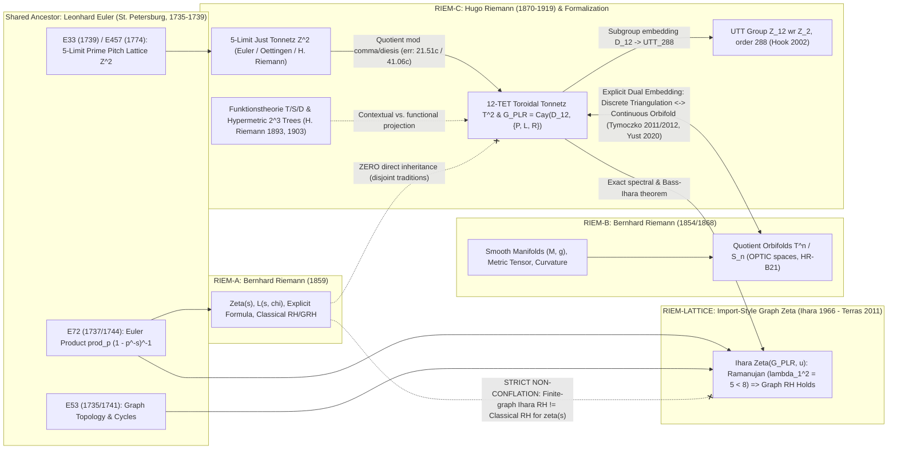

# Riemannian Disambiguation Model & Machine-Foundational Map

**Organization**: Ergentics · **Copyright**: © 2026 Ergentics, LLC (MIT License)  
**Status**: Research & Foundational Specification (Pre-Rung-1)  
**Primary Data Vaults & Companion Specs**:  
- Analytic Number Theory (`RIEM-A`): [`formulary_lineage_v1.json`](../data/sources/formulary_lineage_v1.json)  
- Hugo Riemann & Formalization Lineage (`RIEM-C`): [`hugo_riemann_works_v1.json`](../data/sources/hugo_riemann_works_v1.json)  
- Euler 1730s Root & Import-Style Riemann Lattice Graph RH (`RIEM-LATTICE`): [`riemann_lattice_graph_rh_v1.json`](../data/sources/riemann_lattice_graph_rh_v1.json) · [`riemann_lattice_graph_rh_model.md`](riemann_lattice_graph_rh_model.md)  
- Verification Methodology: [`methodology_literature_v1.json`](../data/sources/methodology_literature_v1.json)

---

## 1. Purpose & Core Anti-Conflation Principle

In mathematics, physics, music theory, and computational modeling, the adjective **"Riemannian"** refers to **three distinct intellectual lineages authored by two completely unrelated German scholars**:

1. **`RIEM-A` — Bernhard Riemann (1826–1866), Analytic Number Theory**: $\zeta(s)$, analytic continuation, explicit prime-zero formula, and the Riemann Hypothesis (1859).
2. **`RIEM-B` — Bernhard Riemann (1826–1866), Differential Geometry**: Smooth $n$-dimensional manifolds $(M, g)$, intrinsic metric tensors, and sectional/Riemann curvature (1854 lecture, pub. 1868).
3. **`RIEM-C` — Hugo Riemann (1849–1919), Music Theory & Musicology**: Harmonic dualism (*Oberklang*/*Unterklang*), *Schritte/Wechsel* transformations, tonal function theory (*Funktionstheorie*: `T, S, D`), *Tonnetz* relations, anacrustic metric/phrase trees (*Achttaktigkeit*), and cognitive *Tonvorstellungen* (1870–1919) — together with its **strictly distinct 20th/21st-century mathematical formalization** **`RIEM-C-ALG`** (Neo-Riemannian group theory: $PLR \cong D_{12}$, Uniform Triadic Transformations $\text{UTT}_{288}$, Generalized Contextual Groups).

Conflating these traditions introduces silent semantic corruption when building formal models and machine-checked code across standalone **Rust**, **Swift**, and **Lean** compartments. Under SCargo's governing **Correspondence Principle** (*every deeper theory must smoothly contain the older theory inside its proven dimensionless regime, with a quantifiable error bound on the mismatch*), any relation between layers MUST be an explicit, typed morphism with an explicit mismatch bound — never a shared surname or overloaded symbol.

---

## 2. National-Library Authority Control (Zero Identity Conflation)

Verified directly from the official **Deutsche Biographie / Neue Deutsche Biographie (NDB, Vol. 21, 2003)** and **German National Library (DNB GND)** authority records:

| Field | Georg Friedrich Bernhard Riemann | Karl Wilhelm Julius Hugo Riemann |
|---|---|---|
| **DNB GND ID** | **`118600869`** | **`118600877`** |
| **Authority Record** | [NDB 21 (2003), pp. 591–592 (Peter Ullrich)](https://www.deutsche-biographie.de/gnd118600869.html#ndbcontent) & ADB 28 (1889), pp. 555–559 (Moritz Cantor) | [NDB 21 (2003), pp. 592–594 (Michael Arntz)](https://www.deutsche-biographie.de/gnd118600877.html#ndbcontent) |
| **Lifespan** | 17 Sep 1826 (Breselenz, Hanover) – 20 Jul 1866 (Selasca, Lago Maggiore) | 18 Jul 1849 (Großmehlra, Thuringia) – 10 Jul 1919 (Leipzig) |
| **Pseudonym** | None | *Hugibert Ries* (1870–1872 *NZfM* essays) |
| **Familial Link** | Father: Friedrich Bernhard Riemann († 1855), pastor in Breselenz/Quickborn | Father: Robert Riemann (1824–1896), estate owner in Großmehlra — **unrelated lineage** |
| **Academic Lineage** | Ph.D. Göttingen 1851 (C. F. Gauß); Habilitation 1854; Prof. Göttingen 1859 | Ph.D. Göttingen 1873 (H. Lotze & E. Krüger); Habilitation Leipzig 1878; Prof. Leipzig 1901/1911 |
| **Primary Vault in SCargo** | `formulary_lineage_v1.json` (`RIEM-A`); geometry primary refs below (`RIEM-B`) | `hugo_riemann_works_v1.json` (`RIEM-C` + typed `HR-BRIDGE`) |

> **Historical Coincidence Note**: Both men took their doctorates at the University of Göttingen (22 years apart: Bernhard in 1851 under Gauss; Hugo in 1873 under philosopher Hermann Lotze and music scholar Eduard Krüger after Oscar Paul rejected his thesis in Leipzig). They had no familial relation and worked in disjoint fields.

---

## 3. Three-Way Lineage & Foundational Object Matrix

| Dimension | `RIEM-A`: Analytic Number Theory | `RIEM-B`: Differential Geometry | `RIEM-C` / `RIEM-C-ALG`: Harmonic & Metric Music Theory |
|---|---|---|---|
| **Originating Author** | Bernhard Riemann (1826–1866) | Bernhard Riemann (1826–1866) | Hugo Riemann (1849–1919); later formalized by Lewin, Hyer, Cohn, Hook, Fiore–Satyendra |
| **Founding Primary Text** | *Ueber die Anzahl der Primzahlen unter einer gegebenen Grösse*, Monatsber. Königl. Preuß. Akad. Wiss. Berlin (Nov. 1859 / pub. 1860), pp. 671–680 (`SRC-02`) | *Ueber die Hypothesen, welche der Geometrie zu Grunde liegen* (Habilitation lecture, 10 Jun 1854), *Abh. Kgl. Ges. Wiss. Göttingen* 13 (1868), pp. 133–150; Eng. trans. W. K. Clifford, *Nature* 8 (1873), pp. 14–17, 36–37 (`doi:10.1038/008036a0`); critical ed. J. Jost, Springer (2016, `doi:10.1007/978-3-319-26042-6`) | *Musikalische Syntaxis* (1877, `HR-T06`), *Vereinfachte Harmonielehre* (1893, `HR-T12`), *System der musikalischen Rhythmik und Metrik* (1903, `HR-R09`), *Das Problem des harmonischen Dualismus* (1905, `HR-T13`), *Ideen zu einer "Lehre von den Tonvorstellungen"* (1914/15, `HR-T16`) |
| **Core Mathematical Objects** | Complex meromorphic functions $\zeta(s)$, $L(s, \chi)$; Euler products; critical strip $0 < \operatorname{Re}(s) < 1$; adelic/automorphic theta lifts; Guinand–Weil positivity | Smooth manifolds $M^n$; positive-definite metric tensor $g_{ij}(x)\,dx^i dx^j$; Levi-Civita connection $\nabla$; Riemann curvature tensor $R^l_{ijk}$; geodesics | Dual *Klänge* $(r, \sigma) \in \mathbb{Z}_{12} \times \{+, -\}$; tonal function classes $\{T, S, D\}$; *Schritte/Wechsel* $\cong PLR \cong D_{12}$; $\text{UTT}_{288} \cong \mathbb{Z}_{12} \wr \mathbb{Z}_2$; *Tonnetz* lattice ($\mathbb{Z}^2$ / $\mathbb{T}^2$); binary hypermetric trees ($2^3$ *Achttaktigkeit*) |
| **Core Symmetry / Duality** | Functional reflection $s \leftrightarrow 1 - s$; Weil / Howe / Pontryagin duality | Tangent–cotangent metric isomorphism $g^\flat, g^\sharp$; Hodge star duality | Harmonic dualism (major $\leftrightarrow$ minor polarity); exact mutual centralizer duality $C_{S_{24}}(T/I) = PLR$ and $C_{S_{24}}(PLR) = T/I$ (Crans–Fiore–Satyendra 2009, `HR-B16`) |
| **Repository Anchor** | [`Ergentics1/Riemannian`](https://github.com/Ergentics1/Riemannian) (`51d9b1a280`) | Reference geometry layer (continuous metric/orbifold foundations) | `SCargo/data/sources/hugo_riemann_works_v1.json` (88 verified entries: 65 Hugo Riemann primary/editorial + 1 contemporaneous 1909 *Festschrift* catalog + 22 non-Hugo typed bridge entries) |

---

## 4. High-Risk Symbol & Terminology Collision Matrix

When designing standalone machine foundational pieces in Rust, Swift, and Lean, the following overloaded letters and terms MUST NEVER appear unqualified across compartments:

| Symbol / Term | Meaning in `RIEM-A` (Analytic NT) | Meaning in `RIEM-B` (Diff. Geometry) | Meaning in `RIEM-C` / `RIEM-C-ALG` (Hugo / Neo-Riemannian) | Required Disambiguated Identifier |
|---|---|---|---|---|
| **`R`** | Real field $\mathbb{R}$ / ring | Riemann curvature tensor $R^l_{ijk}$ | Relative (*Parallelklang*) involution $R \in D_{12}$ | `RealField` / `CurvatureTensor` / `TriadOp::Relative` |
| **`T`** | Imaginary-height bound $T$ in $N(T)$ | Tangent bundle $TM$ / tensor | Tonic function `T` (`HR-T12`) or Transposition $T_n$ (`HR-B06`) | `ZeroHeightBound` / `TangentBundle` / `TonalFunction::Tonic` / `PitchOp::Transpose` |
| **`L`** | Dirichlet / Hecke $L$-function $L(s, \chi)$ | Geodesic arc-length functional $L(\gamma)$ | Leading-tone exchange (*Leittonwechsel*) $L \in D_{12}$ (`HR-T06`, `HR-B08`) | `DirichletL` / `ArcLength` / `TriadOp::Leittonwechsel` |
| **`P`** | Prime set $\mathbb{P}$ / parabolic subgroup | Parallel transport operator | Parallel (*Variantklang*) involution $P \in D_{12}$ (`HR-B08`) | `PrimeSet` / `ParallelTransport` / `TriadOp::Parallel` |
| **`S`, `D`** | Complex parameter $s = \sigma + it$; discriminant $D$ | Scalar curvature $S$; covariant derivative $D$ | Subdominant `S` / Dominant `D` (`HR-T12`); *Schritt* $S$ (`HR-T06`, `HR-B07`) | `ComplexS` / `ScalarCurvature` / `TonalFunction::{Subdominant, Dominant}` / `Schritt` |
| **Metric** | Metric space on $\mathbb{C}$ / adeles | Smooth metric tensor $g$ on $M$ | Musical *Metrik* (accentual weight & hypermetric period hierarchy, `HR-R09`) | `AdelicNorm` / `RiemannianMetricTensor` / `HypermetricTree` |
| **Function** | Analytic / automorphic function | Smooth map $f \in C^\infty(M)$ | Tonal function (*Funktionstheorie*: equivalence class of chords wrt tonic, `HR-T12`) | `MeromorphicFn` / `SmoothMap` / `TonalFunctionClass` |
| **Dualism / Duality** | Functional equation $s \leftrightarrow 1-s$; Howe dual pair | Cotangent / Hodge / Poincaré duality | Harmonic dualism (*Oberklang*/*Unterklang*) & $T/I \leftrightarrow PLR$ centralizer duality | `HoweDualPair` / `HodgeDual` / `HarmonicPolarity` / `CentralizerDualD12` |
| **Harmonic** | Harmonic analysis (Fourier / Tate / automorphic) | Harmonic forms ($\Delta \omega = 0$) | Triadic / functional chord progression (*Harmonik*) | `AdelicHarmonicAnalysis` / `HodgeHarmonicForm` / `TriadicHarmony` |

---

## 5. Legitimate Bridges Under the Correspondence Principle (With Explicit Error Bounds)

Rejecting conflation does **not** isolate valid mathematical connections; it forces every connection to be a **typed projection or embedding with an explicit regime and quantifiable mismatch bound**:

### 5.1 Internal Correspondence Boundaries Within `RIEM-C`

1. **Acoustic Undertones (1875) $\to$ Logical/Cognitive Dualism (1905, 1914/15)**:
   - *Regime failure*: Hugo Riemann's 1875 claim (`HR-T04`) of physically audible undertones in air waves failed experimental replication.
   - *Preserved core*: In 1905 (`HR-T13`) and 1914/15 (`HR-T16`), Riemann explicitly decoupled dualism from acoustics, preserving **structural inversional symmetry** as a cognitive-relational property — later vindicated purely combinatorially by Cohn (`HR-B10`: uniqueness of set class `[037]` in $\mathbb{Z}_{12}$) and algebraically by Crans–Fiore–Satyendra (`HR-B16`: exact centralizer duality $C_{S_{24}}(T/I) = PLR$).
2. **5-Limit Just-Intonation *Tonnetz* ($\mathbb{Z}^2$) $\twoheadrightarrow$ 12-TET Toroidal *Tonnetz* ($\mathbb{T}^2 = \mathbb{Z}^2 / \Lambda_{12}$)**:
   - *Exact dimensionless mismatch bounds*: Passing from the infinite rational fifth/major-third lattice $\{(a, b) \in \mathbb{Z}^2 \mapsto 3^a 5^b \bmod 2^\mathbb{Z}\}$ (Euler `HR-B01`, Oettingen `HR-B04`, Hugo Riemann `HR-T16`) to 12-tone equal temperament identifies lattice vectors modulo:
     - **Syntonic comma**: $(4, -1) \mapsto \frac{3^4}{5 \cdot 2^4} = \frac{81}{80} \approx 21.506\text{ cents}$ (mismatch $\varepsilon_{\text{comma}} = 1200 \log_2(81/80)$);
     - **Enharmonic diesis**: $(0, 3) \mapsto \frac{2^7}{5^3} = \frac{128}{125} \approx 41.059\text{ cents}$ (mismatch $\varepsilon_{\text{diesis}} = 1200 \log_2(128/125)$);
     - **Pythagorean comma**: $(12, 0) \mapsto \frac{3^{12}}{2^{19}} = \frac{531441}{524288} \approx 23.460\text{ cents}$.
   - In machine models, `JustTonnetzZ2` and `EqualTemperedTonnetzT2` MUST be distinct types related by an explicit quotient homomorphism carrying these exact comma bounds.
3. **Hugo Riemann's *Schritte/Wechsel* (`HR-T06`) $\xrightarrow{\cong}$ Neo-Riemannian `PLR` ($D_{12}$, `HR-B07`/`HR-B08`) $\hookrightarrow$ $\text{UTT}_{288}$ (`HR-B14`)**:
   - *Provenance boundary*: Hugo Riemann defined *Schritte* and *Wechsel* dualistically on rooted major/minor *Klänge* (`HR-T06`); Brian Hyer (`HR-B08`), Henry Klumpenhouwer (`HR-B07`), and Julian Hook (`HR-B14`) proved that the 12-TET *Schritt/Wechsel* group is isomorphic to $\langle P, L, R \rangle \cong \langle L, R \rangle \cong D_{12}$ (order 24), sitting inside Hook's order-288 wreath product $\text{UTT} = \mathbb{Z}_{12} \wr \mathbb{Z}_2$ alongside $T/I$.
   - *Exact regime difference*: `Funktionstheorie` (`HR-T12`: tonic-centric `T/S/D` classes) operates inside a **key-relative (diatonic-centered) regime**, whereas `PLR` / `UTT` (`HR-B08`–`HR-B16`) operates in a **key-free (chromatic, contextually invariant) regime**. Neither replaces the other; both compose cleanly when typed separately.

### 5.2 Legitimate Cross-Tradition Bridge: `RIEM-C` $\leftrightarrow$ `RIEM-B`

- **Callender, Quinn, & Tymoczko (2008, *Science*, `HR-B21`) & Tymoczko (2011, 2012, `HR-B22`) & Yust (2020, `HR-B22`)**:
  - Continuous $n$-note chord space under Octave, Permutation, Transposition, Inversion, and Cardinality (OPTIC) equivalences forms a **quotient orbifold** $\mathbb{T}^n / S_n$ (for triads: a twisted triangular prism / Möbius-prism quotient) carrying a Euclidean/Riemannian metric (`RIEM-B`).
  - The discrete Neo-Riemannian *Tonnetz* dual (Chicken-Wire Torus, Douthett–Steinbach `HR-B12`) embeds as a discrete 1-skeleton / dual cell complex inside this orbifold (`RIEM-C-ALG` $\hookrightarrow$ `RIEM-B`), with continuous $L_1$/$L_2$ voice-leading distance recovering exact discrete semitone counts on integer lattice points.
  - Yust (`HR-B22`, 2020) extends this same simplicial/toroidal topology from pitch (*Tonnetze*) to rhythm/meter (*Zeitnetze*), offering a formal mathematical bridge between Hugo Riemann's harmonic (`HR-T16`) and metric (`HR-R09`) theories.

### 5.3 Hard Non-Bridge (`RIEM-C` $\not\leftrightarrow$ `RIEM-A`) & True Shared Ancestor: Leonhard Euler's Late-1730s St. Petersburg Trunk (`RIEM-LATTICE`)

- **Hard Non-Conflation Wall**: There is **zero direct theoretical derivation** connecting Hugo Riemann's harmonic/metric music theory (`RIEM-C`) to Bernhard Riemann's 1859 analytic zeta function and the classical Riemann Hypothesis (`RIEM-A`, `Ergentics1/Riemannian`). Nor does any finite-graph zeta theorem prove or imply the classical Riemann Hypothesis for $\zeta(s)$.
- **True Shared Historical Trunk (Euler, St. Petersburg, 1735–1739)**: Both lineages genuinely descend from **Leonhard Euler's late-1730s St. Petersburg trilogy** (`riemann_lattice_graph_rh_v1.json`):
  1. `E53` (1735 / pub. 1741, *Solutio problematis ad geometriam situs pertinentis*): graph topology and closed cycles;
  2. `E72` (Apr. 25, 1737 / pub. 1744, *Variae observationes circa series infinitas*): the Euler product $\prod_p (1 - p^{-s})^{-1}$ (ancestor of both Bernhard Riemann's `RIEM-A` and Ihara's graph zeta Euler product);
  3. `E33` (1739, *Tentamen novae theoriae musicae*) & `E457` (1774, *Speculum Musicum*): the 5-limit prime pitch lattice $\mathbb{Z}^2$ (ancestor of Oettingen and Hugo Riemann's `RIEM-C` *Tonnetz*).
- **Import-Style Riemann Lattice Synthesis (`RIEM-LATTICE`)**: As proven with exact $\mathbb{Z}/\mathbb{Q}$ arithmetic in [`riemann_lattice_graph_rh_model.md`](riemann_lattice_graph_rh_model.md), applying the Euler–Ihara–Sunada–Bass–Terras zeta machinery to the Neo-Riemannian *Tonnetz* Dual $G_{PLR} = \operatorname{Cay}(D_{12}, \{P, L, R\})$ (24 vertices, 3-regular bipartite Chicken-Wire Torus, $q = 2$) establishes that $G_{PLR}$ is a **Ramanujan graph** ($\max_{\lambda \neq \pm 3} \lambda^2 = 5 < 8 = 4q$, exact integer margin $3$) whose completed zeta satisfies $\Xi_{G_{PLR}}(2^{-s}) = \Xi_{G_{PLR}}(2^{-(1-s)})$ and unconditionally satisfies the **Graph Riemann Hypothesis**—with a quantifiable Correspondence-Principle boundary under $N$-TET refinement (`12-TET` passes with margin $+3$; `31-TET` barely passes with $+0.021$; `17, 27, 41, 53-TET` fail via Alon–Boppana as they approach Euler's amenable flat $\mathbb{Z}^2$ honeycomb limit).
- **Strict Import Discipline**: Shared abstract primitives (Euler products, finite groups $D_{12}$, cyclic rings $\mathbb{Z}_m$, lattices $\mathbb{Z}^2$, Ihara determinants) live in their own disjoint `RIEM-LATTICE` import module rather than leaking into `RIEM-A`.

---

## 6. Machine-Foundational Primitives & Namespace Isolation Contract

Before building Rung 1 code in standalone **Rust**, **Swift**, and **Lean** compartments, any foundational piece derived from `hugo_riemann_works_v1.json` or `riemann_lattice_graph_rh_v1.json` must obey this isolation contract:

### 6.1 Required Namespace Isolation (Standalone Per Language)
- **Rust**: Disjoint modules `riem_analytic::` (`RIEM-A`), `riem_geometry::` (`RIEM-B`), `riem_harmonic::` (`RIEM-C` / `RIEM-C-ALG`), and `riem_lattice::` (`RIEM-LATTICE`).
- **Swift**: Disjoint modules/enums `RiemAnalytic` (`RIEM-A`), `RiemGeometry` (`RIEM-B`), `RiemHarmonic` (`RIEM-C` / `RIEM-C-ALG`), and `RiemLattice` (`RIEM-LATTICE`).
- **Lean**: Disjoint namespaces `SCargoLean.RiemAnalytic`, `SCargoLean.RiemGeometry`, `SCargoLean.RiemHarmonic`, and `SCargoLean.RiemLattice`.

### 6.2 Core Machine-Foundational Primitives Extracted from `RIEM-C` & `RIEM-LATTICE`
1. **Dual *Klang* Representation (`HR-T06`, `HR-B07`)**: `(root: ZMod 12, polarity: Major | Minor)` — lossless representation distinguishing over-triads and under-triads.
2. **Tonal Function Classifier (`HR-T12`, `HR-B17`)**: Key-indexed equivalence classes `{Tonic, Subdominant, Dominant}` with explicit *Scheinkonsonanz* (`Parallel`, `Leittonwechsel`) substitution witnesses.
3. **Dihedral Action & Centralizer Pair (`HR-B08`, `HR-B14`, `HR-B16`)**: Simply transitive actions of $T/I \cong D_{12}$ and $S/W \cong PLR \cong D_{12}$ on the 24 consonant triads, with machine-checkable mutual centralizer law $g \circ h = h \circ g\ \forall g \in T/I, h \in PLR$ and embedding into $\text{UTT}_{288}$.
4. **Two-Tier *Tonnetz* & Comma Quotient (`HR-T16`, `HR-L16`, `HR-B01`, `HR-B04`)**: Exact rational lattice $\mathbb{Z}^2$ (5-limit just intonation) paired with explicit quotient map to $\mathbb{T}^2$ (12-TET) exposing exact syntonic-comma and diesis mismatch bounds.
5. **Import-Style Riemann Lattice & Ihara Graph-RH Verifier (`RL-01`–`RL-11`)**: Exact integer characteristic polynomial of $B B^\top$ for $G_{PLR}$, Bass–Ihara determinant identity & $s \leftrightarrow 1 - s$ functional equation, minimal prime-hexagon decomposition (`12 LPRLPR + 4 LPLPLP`), and $N$-TET Ramanujan regime-boundary sweep.
6. **Hierarchical Anacrustic Metric Tree (`HR-R04`, `HR-R09`, `HR-T17`)**: End-accented binary period trees ($2^3$ *Achttaktigkeit*) with typed contraction (elision), expansion, and triple-metric deviation rewrite rules.

### 6.3 Atomic Boolean Guards for Reference & Model Integrity
1. `tradition_tag_present`: Every source entry carries an explicit `tradition_id` (`RIEM-A`, `RIEM-B`, `RIEM-C`, `RIEM-C-PRECURSOR`, `RIEM-C-ALG`, `RIEM-C-HIST`, `RIEM-C-TO-RIEM-B-BRIDGE`, `EULER-TRUNK`, or `RIEM-LATTICE`).
2. `hugo_vs_neo_provenance_explicit`: Every entry in `hugo_riemann_works_v1.json` carries boolean `authored_by_hugo_riemann` and typed `provenance_role`, preventing 20th-century Neo-Riemannian group theorems from being misattributed to Hugo Riemann's 19th-century texts.
3. `no_wikipedia_reference_urls`: Zero entries cite crowdsourced encyclopedia domains; 100% point to primary archives, national libraries, university presses, or peer-reviewed journals/arXiv preprints.
4. `no_cross_tradition_vault_leakage`: Zero ID collisions or cross-leakage across disjoint source vaults (`SRC-*` in `formulary_lineage_v1.json`, `METH-*` in `methodology_literature_v1.json`, `HR-*` in `hugo_riemann_works_v1.json`, `RL-*` in `riemann_lattice_graph_rh_v1.json`).

