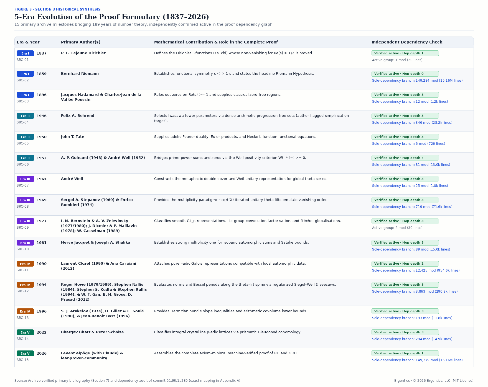
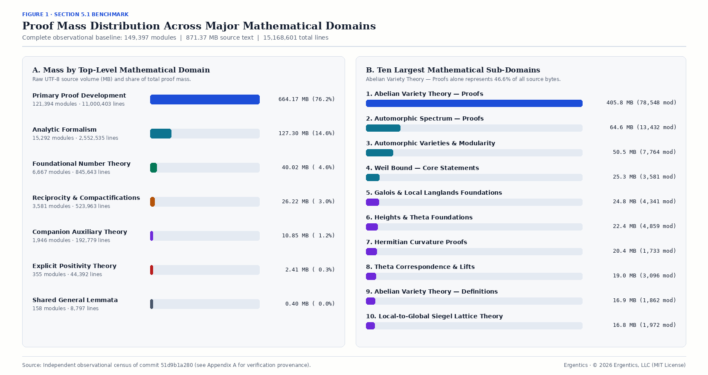
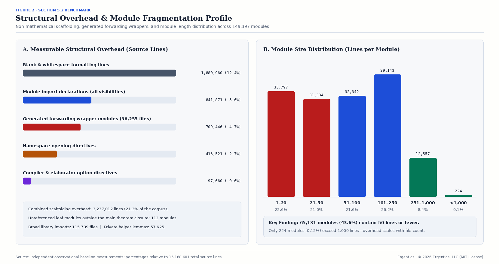
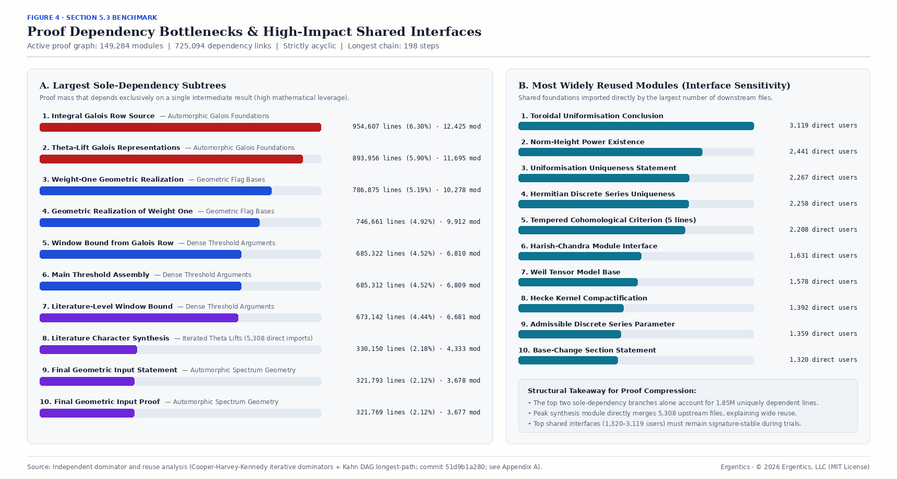

# Understanding and Compressing a Machine-Verified Proof of the Riemann Hypothesis: A Five-Era Primary-Source Synthesis, Standardized Vocabulary, and Clean-Room Empirical Framework

**Ergentics Working Paper Series — Paper 001**  
**Organization**: Ergentics · **Copyright**: © 2026 Ergentics, LLC (MIT License)  
**Edition**: Working Paper v2.0 (Clean-Room Baseline & Teaching Synthesis)  
**Subject Areas**: Analytic & Arithmetic Number Theory · Formalized Mathematics · Empirical Proof Engineering  
**Keywords**: Riemann Hypothesis, Generalized Riemann Hypothesis, Historical Formulary, Standardized Lexicon, Proof Compression, Dependency Analysis, Stratified Controlled Trials, Clean-Room Architecture

---

## Abstract

In November 2026, a complete, axiom-minimal machine-checked formalization of the Riemann Hypothesis (RH) and the Generalized Riemann Hypothesis (GRH) for Dirichlet $L$-functions was released in the Lean 4 proof assistant (Alpöge, 2026). Verified using only the three standard foundations of classical mathematics—propositional extensionality, quotient soundness, and the axiom of choice—the proof represents a landmark in formal verification. Yet its physical scale creates an immediate barrier to human comprehension, independent auditing, and mathematical reuse: following an initial community port to Lean 4.36, the proof still spans **149,397 individual modules**, **15,168,601 lines of source text**, and **871.37 megabytes** of code, requiring roughly 187–240 core-hours to compile. As its author remarked upon publication, the formalization contains substantial structural and mathematical slack waiting to be simplified.

This working paper establishes the scholarly and empirical foundation required to reduce that proof mass responsibly, **before** modifying a single line of the verified proof. Adopting a teaching-first, clean-room approach, we contribute four foundational instruments:

1. **A Standardized Cross-Era Vocabulary (Section 2)** that harmonizes terminology across 189 years of number theory (1837–2026) and establishes plain, consistent language for empirical proof measurement.
2. **A Five-Era Primary-Source Synthesis (Section 3)** tracing fifteen load-bearing mathematical milestones directly from primary archival publications to their active roles in the complete proof—explaining *why* a proof of the Riemann Hypothesis weaves together classical $L$-functions, adelic Fourier analysis, Stepanov-style multiplicity via iterated unitary theta lifts, regularized Siegel–Weil periods, automorphic Galois compatibility, Arakelov slope geometry, and prismatic integral $p$-adic Hodge theory.
3. **A Clean-Room Research Architecture & Dual Empirical Design (Section 4)** drawing on aerospace containment and interface-control principles to separate analysis from the verified reference proof, separate executable tooling from immutable measurement datasets, and pair **Observational Baseline Studies** with **Stratified Controlled Trials** governed by five hard safety invariants.
4. **Independent Structural & Dependency Benchmarks (Section 5)** built entirely from first principles without relying on external traces. Our benchmarks reveal sharp concentration: Abelian Variety Theory proofs alone account for nearly half of all source bytes (**405.8 MB across 78,548 modules**); **43.6% of all modules (65,131 files)** contain 50 lines or fewer; non-mathematical scaffolding accounts for **21.3% of all lines (3,237,012 lines)**; **36,255 modules (709,446 lines)** are generated forwarding wrappers; **112 modules** are completely unreferenced by the main theorem; and our independent dependency analysis confirms a strictly acyclic graph of **149,284 active modules** (longest chain: **198 steps**) whose largest uniquely dependent branches and most widely reused interfaces provide a clear, safety-first roadmap for systematic proof compression.

---

## Table of Contents

- [1. Introduction: Why Compression Begins With Comprehension](#1-introduction-why-compression-begins-with-comprehension)
- [2. A Standardized Cross-Era Vocabulary](#2-a-standardized-cross-era-vocabulary)
  - [2.1 Bridging Five Mathematical Eras](#21-bridging-five-mathematical-eras)
  - [2.2 Clean-Room Measurement & Methodology Lexicon](#22-clean-room-measurement--methodology-lexicon)
- [3. Historical Evolution of the Proof Formulary (1837–2026)](#3-historical-evolution-of-the-proof-formulary-18372026)
  - [3.1 Era I — Classical Analytic Foundations (1837–1896)](#31-era-i--classical-analytic-foundations-18371896)
  - [3.2 Era II — Adelic Harmonic Analysis & Explicit Positivity (1946–1952)](#32-era-ii--adelic-harmonic-analysis--explicit-positivity-19461952)
  - [3.3 Era III — Multiplicity, Theta Lifts & Automorphic Representations (1964–1989)](#33-era-iii--multiplicity-theta-lifts--automorphic-representations-19641989)
  - [3.4 Era IV — Regularized Periods, Galois Compatibility & Arithmetic Slopes (1974–2012)](#34-era-iv--regularized-periods-galois-compatibility--arithmetic-slopes-19742012)
  - [3.5 Era V — Integral p-adic Hodge Theory & Machine-Verified Synthesis (2022–2026)](#35-era-v--integral-p-adic-hodge-theory--machine-verified-synthesis-20222026)
- [4. Clean-Room Research Architecture & Experimental Design](#4-clean-room-research-architecture--experimental-design)
  - [4.1 Clean-Room Separation & Interface Boundaries](#41-clean-room-separation--interface-boundaries)
  - [4.2 Separating Executable Code From Immutable Data](#42-separating-executable-code-from-immutable-data)
  - [4.3 Language Specialization Across Compartments](#43-language-specialization-across-compartments)
  - [4.4 Dual Empirical Methodology: Observational Audits & Stratified Controlled Trials](#44-dual-empirical-methodology-observational-audits--stratified-controlled-trials)
- [5. Empirical Benchmarks & Dependency Structure](#5-empirical-benchmarks--dependency-structure)
  - [5.1 Proof Mass Distribution Across Mathematical Domains](#51-proof-mass-distribution-across-mathematical-domains)
  - [5.2 Structural Overhead & Module Fragmentation](#52-structural-overhead--module-fragmentation)
  - [5.3 Independent Dependency Bottlenecks & Shared Interfaces](#53-independent-dependency-bottlenecks--shared-interfaces)
- [6. Prioritized Compression Roadmap & Methodological Limitations](#6-prioritized-compression-roadmap--methodological-limitations)
  - [6.1 Three Progressive Compression Tiers](#61-three-progressive-compression-tiers)
  - [6.2 Methodological Limitations & Environmental Constraints](#62-methodological-limitations--environmental-constraints)
- [7. Primary Bibliography (Archive-Verified, 1837–2026)](#7-primary-bibliography-archive-verified-18372026)
- [Appendix A. Clean-Room Provenance & Verification Mapping](#appendix-a-clean-room-provenance--verification-mapping)

---

## 1. Introduction: Why Compression Begins With Comprehension

Formalizing a deep mathematical proof in a computer proof assistant achieves an extraordinary guarantee: every logical deduction is checked from axioms by a small, trusted kernel. At the same time, large machine-assisted formalizations introduce a new scientific challenge. When a verified proof grows to fifteen million lines spread across nearly one hundred fifty thousand files, no single mathematician can read it linearly, and even routine maintenance—upgrading the proof assistant, checking build reproducibility, or extracting reusable theorems for general mathematical libraries—becomes prohibitively expensive.

Experience from early community reduction efforts shows why ad-hoc global editing fails at this scale:

- **Proof size is not a single number.** Reducing module count, source lines, raw bytes, exported kernel proof-term size, and compilation compute time often pull against one another. For example, replacing broad imports with minimal module-level imports can trim compilation CPU time by roughly 11–22% while increasing the total number of import lines nearly eightfold.
- **Mechanical consolidation carries hidden semantic hazards.** Merging small files naively can trigger subtle name shadowing, implicit-versus-explicit binder collisions, or changes in automatically generated simplification lemmas that break distant proofs.
- **Pruning purely from exported kernel terms breaks interactive proof checking.** Automated tactics frequently reference helper lemmas that vanish once unfolded into the final kernel term; deleting those helpers causes source compilation to fail even though the final kernel proof term never mentions them.

For these reasons, meaningful proof compression must follow the same discipline as empirical science and high-reliability engineering: **understand the mathematical architecture first**, establish a **consistent shared vocabulary**, build **independent measurement instruments** inside an isolated clean room, and **test every proposed reduction on controlled samples** before touching the verified reference proof.

---

## 2. A Standardized Cross-Era Vocabulary

A proof spanning nearly two centuries of mathematical development inevitably accumulates overlapping terminology. Classical analysts speak of Dirichlet series and zero-free regions; mid-twentieth-century harmonic analysts speak of adelic integrals and explicit positivity; representation theorists speak of dual reductive pairs, seesaw identities, and smooth factorisations; arithmetic geometers speak of Hermitian vector bundle slopes and prismatic Dieudonné lattices; and formal-verification engineers speak of dominator trees, in-degree hubs, and elaboration scaffolding.

Without a shared lexicon, discussions of proof simplification quickly fragment into incompatible dialects. To maintain **lexical consistency** across this paper and all subsequent experimental work, we maintain a canonical vocabulary dataset (cataloged in Appendix A) that defines every core mathematical and methodological term once and maps historical concepts cleanly across eras.

### 2.1 Bridging Five Mathematical Eras

| Canonical Term | Historical Era | Plain-Language Meaning | Role in the Complete Proof |
|---|---|---|---|
| **Dirichlet Character & $L$-Function** | Era I (1837) | A periodic multiplicative weight $\chi(n) \pmod N$ paired with $L(s, \chi) = \sum \chi(n) n^{-s}$, generalizing $\zeta(s)$ to arithmetic progressions. | Defines the family of functions whose non-vanishing for $\operatorname{Re}(s) > 1/2$ constitutes GRH. |
| **Critical Strip & Functional Symmetry** | Era I (1859–1896) | The vertical band $0 < \operatorname{Re}(s) < 1$ containing all nontrivial zeros, symmetric across $\operatorname{Re}(s) = 1/2$ under $s \leftrightarrow 1-s$. | Together with boundary non-vanishing on $\operatorname{Re}(s) \ge 1$, symmetry reduces RH/GRH to ruling out zeros with $\operatorname{Re}(s) > 1/2$. |
| **Adelic Zeta Integral** | Era II (1950) | Tate's unified Fourier integral taken simultaneously across all real, complex, and $p$-adic completions of a number field. | Supplies Euler products, local root numbers, analytic continuation, and functional equations for Hecke $L$-functions. |
| **Guinand–Weil Positivity Criterion** | Era II (1948–1952) | Explicit prime–zero duality showing RH holds if and only if a quadratic functional $W(f * \tilde{f})$ is non-negative on test functions. | Serves as the analytic bridge turning automorphic and geometric bounds into zero-free half-planes. |
| **Behrend Progression-Free Construction** | Era II (1946) | A dense set of integers containing no three equally spaced elements, constructed via lattice points on high-dimensional spheres. | Selects Iwasawa tower parameters in the original 2026 formalization; explicitly flagged by the author as a simplification candidate. |
| **Multiplicity Paradigm (Stepanov Descendant)** | Era III (1969–1974) | Bounding rational points over finite fields via functions vanishing to high order; emulated over $\mathbb{Z}$ by chaining $\asymp \sqrt{X}$ iterated unitary theta lifts. | Provides the overarching organizing blueprint connecting all automorphic and geometric subsystems. |
| **Weil Unitary & Metaplectic Representation** | Era III (1964) | A canonical unitary representation on the metaplectic double cover generalizing classical theta series to reductive dual pairs. | Powers each link in the iterated theta-lift chain across totally definite unitary groups. |
| **Local Representation & Rigidity Package** | Era III (1977–1989) | Smooth $p$-adic classification (Bernstein–Zelevinsky), Lie-group smooth factorisation (Dixmier–Malliavin), canonical globalisation (Casselman), and strong multiplicity one (Jacquet–Shalika). | Pins down local automorphic components and rules out degenerate cancellations in Satake parameters. |
| **Regularized Siegel–Weil & Seesaw Duality** | Era IV (1979–2012) | Identities expressing regularized theta integrals via Siegel Eisenstein series, paired with Rallis's seesaw formula and Gan–Gross–Prasad period branching. | Evaluates norms and Bessel periods along the central theta-lift spine. |
| **Automorphic Galois Compatibility** | Era IV (1990–2012) | Attaching pure $\ell$-adic Galois representations to regular algebraic cuspidal automorphic representations with matching local parameters (Clozel–Caraiani). | Constructs the integral Galois row anchoring the single largest uniquely dependent branch of the proof graph. |
| **Arakelov Slope & Covolume Inequality** | Era IV (1974–1996) | Arithmetic intersection and Hermitian vector bundle slope estimates (Arakelov, Gillet–Soulé, Bost) bounding lattice covolumes. | Supplies covolume lower bounds and divisibility estimates across the abelian-variety height machinery. |
| **Prismatic Integral Hodge Lattice** | Era V (2022) | Integral $p$-adic cohomology (Bhatt–Scholze) classifying crystalline lattices and $p$-divisible groups without inverting $p$. | Controls integral inertia eigenvalues and crystalline lattice comparisons inside abelian-variety proofs. |

### 2.2 Clean-Room Measurement & Methodology Lexicon

To prevent opaque software or aerospace jargon from obscuring the research narrative, we adopt seven standardized plain-language terms throughout the laboratory:

| Standard Term | Plain-Language Definition | Replaces (Legacy Shorthand to Avoid in Prose) |
|---|---|---|
| **Clean-Room Laboratory** | The isolated workspace where all measurements, models, and controlled trials run without touching the verified proof. | Internal repo nicknames / build-system jargon |
| **Verified Reference Artifact** | The untouched, machine-verified proof tree serving as the ground-truth baseline. | Raw git paths and branch shorthands |
| **Structural Mass Vector** | The five-dimensional size state $\mathbf{M} = (F, L, B, E, C)$: module count, source lines, raw bytes, kernel export size, and compilation cost. | Treating "size" as a single scalar |
| **Sole-Dependency Subtree** | All downstream modules reachable from the main theorem *exclusively* through one intermediate module (graph-theoretically, its dominator subtree). | Bare `dom` / opaque dominator abbreviations |
| **High-Impact Shared Module** | A module imported directly by hundreds or thousands of downstream modules, making its interface highly sensitive to signature edits. | Bare `fan-in` / `in-degree hub` jargon |
| **Scaffolding Overhead & Forwarding Wrappers** | Non-mathematical lines (blanks, imports, namespace openings, compiler options) plus machine-generated files that simply re-export a neighboring theorem. | Ad-hoc labels like "glue", "boilerplate", or raw tactic templates |
| **Observational Baseline & Stratified Controlled Trial** | Two-stage empirical protocol: first measuring the full untouched corpus, then evaluating candidate compression rules on balanced, randomly allocated treatment and control module pairs stratified by domain and size. | Informal "spot checks" or unstratified benchmarks |

---

## 3. Historical Evolution of the Proof Formulary (1837–2026)

A central teaching goal of this paper is to answer a question every mathematician asks when first encountering the 2026 formalization: *why does a proof of an 1859 conjecture about prime numbers invoke unitary theta lifts, Arakelov geometry, automorphic Galois representations, and prismatic cohomology?*

Tracing fifteen primary milestones directly from archival publications reveals a coherent, five-era conceptual arc. Rather than an accidental collage of fields, each era supplies one essential link in a single chain of reasoning—and our independent dependency verification confirms that **all fifteen historical pillars are actively reachable from the main theorem** in the live proof graph.

### 3.1 Era I — Classical Analytic Foundations (1837–1896)

The story begins with **P. G. Lejeune Dirichlet (1837)**, who introduced multiplicative characters $\chi \pmod N$ and their associated series $L(s, \chi)$ to prove that every arithmetic progression with coprime modulus contains infinitely many primes. Twenty-two years later, **Bernhard Riemann (1859)** extended the Euler zeta function $\zeta(s)$ meromorphically to the entire complex plane, established its functional symmetry connecting $s$ and $1-s$, linked its complex zeros directly to fluctuations in the prime-counting function, and conjectured that every nontrivial zero lies on the critical line $\operatorname{Re}(s) = 1/2$.

In **1896**, **Jacques Hadamard** and **Charles-Jean de la Vallée Poussin** independently proved that $\zeta(s)$ never vanishes on the boundary line $\operatorname{Re}(s) = 1$, establishing the Prime Number Theorem and carving out the first zero-free regions inside the critical strip. Combined with Riemann's functional symmetry, this classical era reduces both RH and GRH to a clean target statement: proving that $L(s, \chi) \neq 0$ throughout the open half-plane $\operatorname{Re}(s) > 1/2$.

### 3.2 Era II — Adelic Harmonic Analysis & Explicit Positivity (1946–1952)

Mid-twentieth-century number theory transformed classical complex-analytic arguments into harmonic analysis across all places simultaneously. In his landmark Princeton doctoral thesis, **John Tate (1950)** recast Hecke's $L$-functions via Fourier analysis and Poisson summation over the ring of adeles, unifying archimedean and $p$-adic local factors into a single local–global duality.

In parallel, **A. P. Guinand (1948)** and **André Weil (1952)** refined Riemann's explicit formula into an exact duality between prime powers and zeros. Crucially, Weil proved his **positivity criterion**: the Riemann Hypothesis is logically equivalent to the non-negativity of a quadratic distribution $W(f * \tilde{f}) \ge 0$ evaluated on suitable test functions. Within the 2026 formalization, the Guinand–Weil criterion acts as the master analytic bridge converting algebraic and automorphic bounds back into zero-free regions.

During the same decade, **Felix Behrend (1946)** constructed unexpectedly dense subsets of integers containing no three-term arithmetic progression by packing lattice points onto high-dimensional spheres. Remarkably, the 2026 proof invokes Behrend's combinatorial construction to select parameters for an Iwasawa tower—a detour that the proof's author explicitly highlighted as a prime candidate for future mathematical simplification.

### 3.3 Era III — Multiplicity, Theta Lifts & Automorphic Representations (1964–1989)

Why did the Riemann Hypothesis over finite fields yield to elementary methods while the number-field case remained stubbornly open? In **1969**, **Sergei Stepanov**—followed by **Enrico Bombieri's (1974)** streamlined exposition—gave an elementary proof of the Riemann Hypothesis for curves over finite fields by constructing auxiliary polynomials that vanish to high multiplicity at rational points. Over the integers, ordinary differentiation no longer produces arithmetic vanishing multiplicity. As Alpöge explains in his 2026 overview, the organizing idea of the new proof is to **emulate high vanishing multiplicity over $\mathbb{Z}$ by chaining roughly $\sqrt{X}$ iterated theta lifts** across totally definite unitary groups:

$$U(X_0) \longrightarrow U(X_1) \longrightarrow \cdots \longrightarrow U(X_m), \qquad m \asymp \sqrt{X}.$$

Making such an iterated chain rigorous rests on three foundational pillars built between 1964 and 1989:
- **André Weil (1964)** constructed the metaplectic double cover and the Weil unitary representation underlying global theta series.
- **I. N. Bernstein & A. V. Zelevinsky (1977, 1980)** classified smooth irreducible representations of $\mathrm{GL}_n$ over $p$-adic fields via multisegments, complemented on the real side by **Jacques Dixmier & Paul Malliavin's (1978)** smooth convolution factorisation theorem and **William Casselman's (1989)** canonical globalisation of Harish-Chandra modules.
- **Hervé Jacquet & Joseph Shalika (1981)** proved strong multiplicity one for isobaric sums on $\mathrm{GL}_n$ along with sharp Satake parameter bounds, preventing degenerate cancellations when comparing automorphic transfers across places.

### 3.4 Era IV — Regularized Periods, Galois Compatibility & Arithmetic Slopes (1974–2012)

Controlling the norms, periods, and arithmetic heights along a $\sqrt{X}$-step theta chain requires three major advances from late twentieth- and early twenty-first-century arithmetic geometry and automorphic forms:

1. **Regularized Theta Periods & Seesaw Duality**: Building on **Roger Howe's (1979)** framework of dual reductive pairs and **Stephen Rallis's (1984)** inner-product program, **Stephen Kudla & Stephen Rallis (1994)** established the regularized Siegel–Weil formula relating regularized theta integrals to special values of Siegel Eisenstein series. Together with **Wee Teck Gan, Benedict Gross, & Dipendra Prasad's (2012)** branching framework for Bessel periods, these identities govern the non-vanishing and inner products of the iterated unitary lifts.
2. **Automorphic Galois Compatibility**: **Laurent Clozel (1990)** formulated the cohomological purity framework connecting regular algebraic cuspidal automorphic representations to motives and Galois representations, and **Ana Caraiani (2012)** proved full local–global compatibility at ramified primes via monodromy on nearby cycles. In our independent dependency audit (Section 5.3), this integral Galois-representation branch anchors the single largest uniquely dependent subtree of the entire proof.
3. **Arakelov Geometry & Covolume Bounds**: Initiated by **S. J. Arakelov (1974)**, generalized to higher dimensions by **Henri Gillet & Christophe Soulé (1990)**, and sharpened into powerful slope inequalities for Hermitian vector bundles by **Jean-Benoît Bost (1996)**, arithmetic intersection theory supplies the covolume lower bounds and divisibility estimates driving the Abelian Variety Theory machinery—which today represents nearly half of the proof's raw source mass.

### 3.5 Era V — Integral $p$-adic Hodge Theory & Machine-Verified Synthesis (2022–2026)

At the integral $p$-adic boundary, **Bhargav Bhatt & Peter Scholze (2022)** introduced prisms and prismatic cohomology, providing an integral Dieudonné classification of crystalline lattices and $p$-divisible groups without inverting $p$. Within the 2026 proof, prismatic lattices control integral inertia eigenvalues inside the height and Galois arguments.

Finally, **Levent Alpöge (November 2026)** synthesized all four prior eras into a complete, machine-verified Lean 4 proof of RH and GRH, subsequently ported by the Lean community to Lean 4.36. Every single one of the fifteen historical milestones above is confirmed present and active in the live proof dependency graph (full archive citations in Section 7; exact technical module mapping in Appendix A).

---

## 4. Clean-Room Research Architecture & Experimental Design

Compressing a 15-million-line verified proof without introducing regressions requires more than clever heuristics—it requires an engineering environment that makes accidental corruption structurally impossible. Our laboratory architecture adapts proven containment and verification principles from two classic systems-engineering manuals: the **SpaceX *Falcon Payload User's Guide* (Revision 8, May 2025)** and the **NASA *International Space Station Reference Guide* (Nov 2010)**. Rather than importing aerospace acronyms for their own sake, we extract four concrete, plain-language design principles.

### 4.1 Clean-Room Separation & Interface Boundaries

Just as spacecraft payload integration enforces a rigid mechanical separation plane between test equipment and flight hardware, our workflow draws an absolute boundary between the **Clean-Room Laboratory** and the **Verified Reference Artifact**:

- **Zero speculative edits on the reference proof.** During research, measurement, modeling, and controlled trials, the verified proof tree remains strictly read-only.
- **Protected Verification Core.** The core files defining the five target theorem statements, the allowed axiom set, and the compiler toolchain configuration are locked behind an explicit interface boundary and may never be modified without formal written waiver.
- **Automatic Re-Qualification Triggers.** Whenever the upstream reference proof advances to a new revision or upgrades its Lean compiler version, all baseline measurements and active trial qualifications are automatically flagged for re-verification.

### 4.2 Separating Executable Code From Immutable Data

A foundational rule of our clean room is that **executable analysis code never embeds empirical tables, measurements, or repository-specific lists**. Every observation—full-corpus inventories, dependency-graph traces, primary-source bibliographies, standardized vocabulary definitions, interface manifests, and randomized trial allocations—is stored as a versioned, immutable JSON artifact tagged with schema version, tool provenance, and source revision. All charts, summary tables, and reader interfaces are generated programmatically from those immutable datasets.

### 4.3 Language Specialization Across Compartments

Following a **"right tool for the right task for the right environment"** philosophy, executable tooling is organized into three clean, isolated language compartments (with Python used only selectively for figure rendering and compatibility helpers):

| Compartment | Primary Role in the Clean Room | Why This Language Fits |
|---|---|---|
| **Rust** | High-speed parallel corpus telemetry, independent module-dependency & dominator tracing, deterministic randomized trial allocation, and future large-scale mechanical refactoring. | Zero external dependencies, safe multi-threaded filesystem traversal across 150,000 files in seconds, and exact deterministic reproducibility. |
| **Open-Source Swift 6.4** | Strongly typed data-schema modeling, cross-tool contract auditing (verifying revision alignment, graph acyclicity, and cross-tool consistency), and future statistical/numerical modeling. | Strict compile-time concurrency (`Sendable`) and expressive typed serialization (`Codable`) ideal for enforcing clean-room contracts and analytical pipelines. |
| **Lean 4.36** | Formal specification mirroring the five verified theorem targets and three permitted axioms, plus isolated micro-benchmarks testing candidate proof-compression idioms before promotion. | Pinned one-to-one with the verified reference proof's exact compiler and elaborator settings so local experiments match production semantics identically. |

### 4.4 Dual Empirical Methodology: Observational Audits & Stratified Controlled Trials

To prevent confounding and confirmation bias, every reduction hypothesis progresses through two distinct empirical stages:

1. **Observational Baseline Studies**: Complete, non-intrusive measurements of the untouched reference proof—tracking historical evolution from the initial release to the current baseline, cataloging structural overhead, mapping the exact dependency graph, and documenting known failure modes from prior refactoring attempts.
2. **Pre-Registered Stratified Controlled Trials**: Before applying any compression rule across thousands of files, we stratify eligible non-core modules by *(mathematical domain × file-length bucket)* and randomly assign balanced **Treatment** and **Control** pairs using a fixed-seed deterministic generator. For example, our first pre-allocated trial evaluates simplification of generated forwarding wrappers across **162 balanced modules** (81 Treatment / 81 Control).

Every controlled trial must satisfy **Five Hard Safety Invariants** before any net size reduction is even considered for transfer:

1. **Import Integrity**: Zero missing or dangling module references anywhere in the proof tree.
2. **Strict Acyclicity**: The module dependency graph remains completely free of cycles.
3. **Zero Core Drift**: The protected theorem statements, challenge definitions, and build configuration remain byte-for-byte identical.
4. **Full Local Verification**: Every edited module *and* every module that directly imports it compiles cleanly in Lean 4.36.
5. **Axiom & Budget Preservation**: Zero new unproven placeholders (`sorry`), zero additional axioms beyond `{propext, Quot.sound, Classical.choice}`, and zero increases in heartbeat timeouts.

---

## 5. Empirical Benchmarks & Dependency Structure

All measurements in this section come directly from our independent Rust telemetry and dependency engines running read-only over the full reference proof (exact verification provenance and dataset fingerprints are recorded in Appendix A).

### 5.1 Proof Mass Distribution Across Mathematical Domains

Comparing the initial November 2026 release against the current Lean 4.36 baseline shows meaningful early progress—a **14.7% reduction in modules** and **12.7% reduction in source lines**—while confirming that nearly **871 megabytes** of source text remain.

| Corpus Milestone | Modules | Source Lines | Non-Blank Lines | Raw Source Size |
|---|---:|---:|---:|---:|
| Initial Release (Lean 4.33) | 175,187 | 17,374,215 | 15,531,759 | 1,030.53 MB |
| Current Verified Baseline (Lean 4.36) | **149,397** | **15,168,601** | **13,287,641** | **871.37 MB** |
| **Observed Reduction to Date** | **−25,790 (−14.7%)** | **−2,205,615 (−12.7%)** | **−2,244,118 (−14.4%)** | **−159.16 MB (−15.4%)** |

As **Figure 1** illustrates, proof mass is heavily concentrated rather than evenly spread:

- **Primary Proof Development** accounts for **76.2% of all source bytes (664.17 MB)** and **81.3% of all modules (121,394)**.
- Within that domain, **Abelian Variety Theory** alone accounts for **81,499 modules (54.5%)**, **427.80 MB (49.1%)**, and **7.00 million lines**—driven primarily by **Abelian Variety Theory — Proofs** (`78,548` modules, `405.8 MB`).
- **Analytic Formalism** represents the second largest share (**127.30 MB / 14.6%**, `15,292` modules), while **Foundational Number Theory** (`40.02 MB`), **Reciprocity & Compactifications** (`26.22 MB`), **Companion Auxiliary Theory** (`10.85 MB`), and **Explicit Positivity Theory** (`2.41 MB`) are comparatively compact.

*Teaching takeaway*: Broad, unfocused edits across minor foundations yield negligible total compression; meaningful mass reduction must address the structural patterns driving Abelian Variety Theory, Automorphic Spectrum proofs, and Analytic Formalism.

### 5.2 Structural Overhead & Module Fragmentation

Examining *what kind of text* occupies those 15.17 million lines exposes a remarkable structural property: a large fraction of the repository consists of mechanical framing rather than unique mathematical reasoning.

| Measurable Overhead Category | Measured Volume | Share of Corpus | Compression Nature |
|---|---:|---:|---|
| Blank & whitespace formatting lines | 1,880,960 lines | 12.4% | Scales directly with file count |
| Module import declarations (all visibilities) | 841,871 lines | 5.6% | Scales with file fragmentation |
| Generated forwarding wrapper modules | 709,446 lines (36,255 files) | 4.7% | Mechanical template re-exports |
| Namespace opening directives | 416,521 lines | 2.7% | Repeated per fragmented module |
| Compiler & elaborator option directives | 97,660 lines | 0.6% | Repeated per fragmented module |
| **Combined Non-Mathematical Scaffolding** | **3,237,012 lines** | **21.3%** | Blank + import + namespace + option lines |
| Unreferenced leaf modules (outside main closure) | 112 modules | 0.08% | Zero-risk static dead-code pruning |

**Figure 2** highlights the root cause of this scaffolding tax: **extreme module fragmentation**. Exactly **65,131 modules (43.6%) contain 50 lines or fewer** (`33,797` contain 20 lines or fewer), while only **224 modules (0.15%) exceed 1,000 lines**. Nearly one quarter of all files (`36,255`) are short machine-generated forwarding wrappers that restate and re-export a theorem already proven in an adjacent module. In addition, **115,739 files** import the full standard mathematical library wholesale, **57,625 private helper theorems** signal substantial local duplication, and **807 dense lines** contain five or more explicit `@`-instantiations (verbose machine-dumped typeclass terms concentrated in Capelli identity proofs).

### 5.3 Independent Dependency Bottlenecks & Shared Interfaces

File counts and line counts alone cannot tell us *where* a mathematical simplification will ripple across thousands of files or *which* interfaces are too fragile to modify casually. To answer those questions independently—without borrowing third-party graphs—we built our own module-dependency tracer implementing Kahn's topological analysis and the Cooper–Harvey–Kennedy iterative dominator algorithm across the entire corpus.

- **Global Graph Envelope**: Exactly **149,284 modules** are actively reachable from the main theorem (`15,160,514` lines, `870.90 MB`), connected by **725,094 internal dependency links**. The graph is **strictly acyclic**, reaches a **maximum dependency chain length of 198 sequential steps**, and has a maximum shortest-hop distance of **42** from the main theorem.
- **Cross-Tool Consistency**: Our independent corpus scanner and independent dependency tracer agree to the exact module (`149,284` active + `112` unreferenced project modules + `1` standalone challenge specification = `149,397` total).

**Figure 4** reveals three crucial structural insights that govern how compression work should be sequenced:

1. **Concentrated Sole-Dependency Subtrees (High Mathematical Leverage)**: Beneath the top-level conclusion module (which anchors `149,279` modules, or `99.997%` of the active proof), a handful of intermediate milestones each anchor massive uniquely dependent branches:
   - **Integral Galois Row Source** (a 12-line interface file at hop depth 2): uniquely anchors **12,425 modules / 954,607 lines (6.30% of the active proof / 55.11 MB)**.
   - **Window Bound from Galois Row** (hop depth 2): uniquely anchors **6,810 modules / 685,322 lines (4.52% / 40.08 MB)**.
   - **Literature Character Synthesis** (hop depth 2): uniquely anchors **4,333 modules / 330,150 lines (2.18% / 24.98 MB)**, containing the **Siegel–Eisenstein Second-Term Hypotheses** subtree (**3,863 modules / 290,311 lines [1.92%]**).
   - **Final Geometric Input Statement** (hop depth 4): uniquely anchors **3,678 modules / 321,793 lines (2.12% / 19.73 MB)**.
   - **Kato Quadratic Character Window Step** (hop depth 5): uniquely anchors **2,301 modules / 185,601 lines (1.22% / 10.45 MB)**.
2. **A Massive Central Merge Wall**: The **Literature Character Synthesis** module directly imports **5,308 separate upstream modules** in a single file. That extraordinary fan-out explains why over 80% of the proof graph is reachable through multiple overlapping routes rather than hanging off one isolated branch—and marks this merge wall as a high-priority architectural refactoring target.
3. **Interface-Sensitive Shared Foundations**: At the opposite end of the graph sit small, deeply shared foundations imported directly by thousands of files—led by **Toroidal Uniformisation Conclusion** (`3,119` direct users), **Norm-Height Power Existence** (`2,441`), **Uniformisation Uniqueness Statement** (`2,267`), **Hermitian Discrete Series Uniqueness** (`2,258`), and **Tempered Cohomological Criterion** (`2,208` direct users of a 5-line, 56-byte leaf module). During local mechanical trials, these high-impact interfaces must be treated as signature-frozen to avoid triggering thousand-file rebuild cascades.

---

## 6. Prioritized Compression Roadmap & Methodological Limitations

### 6.1 Three Progressive Compression Tiers

Synthesizing our historical lineage, structural overhead census, and independent dependency bottlenecks yields a clear, safety-ordered three-tier research plan:

| Tier | Scope & Approach | Measured Opportunity | Primary Risk Control |
|---|---|---|---|
| **Tier 1 — Zero-Risk Immediate Wins** | Remove the 112 statically unreferenced leaf modules; publish clean 1:1 primary-source theorem attribution notes requiring zero proof recompilation. | 112 modules + immediate scholarly clarity | Verify build-manifest target globs; zero edits to active proof modules. |
| **Tier 2 — Controlled Mechanical Trials** | Run pre-registered stratified controlled trials on (a) replacing/collapsing the 36,255 generated forwarding wrappers, (b) condensing verbose explicit typeclass dumps, and (c) factoring duplicated private helper lemmas across Abelian Variety proofs. | ~600k–950k source lines & up to ~28k–36k modules | Enforce all Five Safety Invariants; freeze top shared interfaces (`>1,000` direct users); check binder-plicity and namespace collisions. |
| **Tier 3 — Deep Mathematical & Architectural Compression** | Refactor the 5,308-import central merge wall; shorten high-leverage sole-dependency branches (Integral Galois Row, Dense Threshold Window, Siegel–Eisenstein Second-Term Hypotheses); prune unused hypothesis fields; revisit author-flagged mathematical detours such as the Behrend progression-free tower selection. | Multi-million-line & order-of-magnitude structural potential | Requires deep mathematical re-proof and full end-to-end kernel + independent verifier acceptance. |

### 6.2 Methodological Limitations & Environmental Constraints

- **Module-Level vs. Declaration-Level Granularity**: Our current independent tracer operates directly on the static Lean module-import graph, enabling complete 150,000-file analysis in under four seconds with zero compiler build dependencies. Extending our tracer in a future phase to read compiled declaration-level graphs will uncover additional unused lemmas and structure fields inside otherwise active modules.
- **Computational Verification Envelope**: Compiling the entire reference proof from scratch requires roughly 187–240 core-hours and over 150 GB of memory for full kernel export. Practical day-to-day trial qualification must therefore combine bounded local compilation on targeted subtrees with cached precompiled artifacts and full continuous-integration verification before any transfer is finalized.
- **Living Upstream Ecosystem**: Active community development (including upcoming Lean 4.37 toolchain upgrades) means our baseline is a moving reference point. By strictly decoupling immutable datasets from executable code and enforcing automatic re-qualification triggers, our clean-room measurements remain reproducible across every future revision.

---

## 7. Primary Bibliography (Archive-Verified, 1837–2026)

Every historical citation below has been independently verified against primary archival records (Gallica, Numdam, PNAS, Oxford Academic, Project Euclid, Annals of Mathematics, AMS, and primary release documents):

1. **Dirichlet, P. G. L. (1837)**. *Beweis des Satzes, dass jede unbegrenzte arithmetische Progression, deren erstes Glied und Differenz ganze Zahlen ohne gemeinschaftlichen Factor sind, unendlich viele Primzahlen enthält*. Abhandlungen der Königlichen Preußischen Akademie der Wissenschaften zu Berlin, 1837, pp. 45–81 (Gallica `ark:/12148/bpt6k99435r/f326`).
2. **Riemann, B. (1859)**. *Ueber die Anzahl der Primzahlen unter einer gegebenen Grösse*. Monatsberichte der Königlichen Preußischen Akademie der Wissenschaften zu Berlin, November 1859 (pub. 1860), pp. 671–680.
3. **Hadamard, J. (1896)**. *Sur la distribution des zéros de la fonction $\zeta(s)$ et ses conséquences arithmétiques*. Bull. Soc. Math. France 24, pp. 199–220 (Numdam `BSMF_1896__24__199_1`).
4. **de la Vallée Poussin, C.-J. (1896)**. *Recherches analytiques sur la théorie des nombres premiers, Première partie*. Ann. Soc. Sci. Bruxelles 20, pp. 183–256.
5. **Behrend, F. A. (1946)**. *On sets of integers which contain no three terms in arithmetical progression*. Proc. Natl. Acad. Sci. USA 32(12), pp. 331–332. `doi:10.1073/pnas.32.12.331`.
6. **Guinand, A. P. (1948)**. *A summation formula in the theory of prime numbers*. Proc. London Math. Soc. (2) 50(1), pp. 107–119. `doi:10.1112/plms/s2-50.2.107`.
7. **Tate, J. T. (1950)**. *Fourier Analysis in Number Fields and Hecke's Zeta-Functions*. Ph.D. thesis, Princeton University; published in J. W. S. Cassels & A. Fröhlich (eds.), *Algebraic Number Theory*, Academic Press (1967), pp. 305–347.
8. **Weil, A. (1952)**. *Sur les « formules explicites » de la théorie des nombres premiers*. Comm. Sém. Math. Univ. Lund (Medd. Lunds Univ. Mat. Sem.), Tome Supplémentaire, pp. 252–265.
9. **Weil, A. (1964)**. *Sur certains groupes d'opérateurs unitaires*. Acta Mathematica 111, pp. 143–211. `doi:10.1007/BF02391012`.
10. **Stepanov, S. A. (1969)**. *On the number of points of a hyperelliptic curve over a finite prime field*. Izv. Akad. Nauk SSSR Ser. Mat. 33 / Math. USSR-Izv. 3(5), pp. 1103–1114. `doi:10.1070/IM1969v003n05ABEH000834`.
11. **Arakelov, S. J. (1974)**. *Intersection theory of divisors on an arithmetic surface*. Math. USSR-Izv. 8(6), pp. 1167–1180.
12. **Bombieri, E. (1974)**. *Counting points on curves over finite fields (d'après S. A. Stepanov)*. Séminaire Bourbaki 1972/73, Exp. 430, Lecture Notes in Math. 383, Springer, pp. 234–241 (Numdam `SB_1972-1973__15__234_0`).
13. **Bernstein, I. N., & Zelevinsky, A. V. (1977)**. *Induced representations of reductive $p$-adic groups I*. Ann. Sci. ÉNS (4) 10(4), pp. 441–472 (Numdam `ASENS_1977_4_10_4_441_0`); **Zelevinsky, A. V. (1980)**, II, Ann. Sci. ÉNS (4) 13(2), pp. 165–210.
14. **Dixmier, J., & Malliavin, P. (1978)**. *Factorisations de fonctions et de vecteurs indéfiniment différentiables*. Bull. Sci. Math. (2) 102, pp. 305–330.
15. **Howe, R. (1979)**. *Theta-series and invariant theory*. Proc. Sympos. Pure Math. 33(1), AMS, pp. 275–285.
16. **Jacquet, H., & Shalika, J. A. (1981)**. *On Euler products and the classification of automorphic representations I & II*. Amer. J. Math. 103(3), pp. 499–558 & 103(4), pp. 777–815.
17. **Rallis, S. (1984)**. *On the Howe duality conjecture*. Compositio Mathematica 51(3), pp. 333–399 (Numdam `CM_1984__51_3_333_0`).
18. **Casselman, W. (1989)**. *Canonical extensions of Harish-Chandra modules to representations of $G$*. Canad. J. Math. 41(3), pp. 385–438. `doi:10.4153/CJM-1989-019-5`.
19. **Clozel, L. (1990)**. *Motifs et formes automorphes: applications du principe de fonctorialité*. In *Automorphic Forms, Shimura Varieties, and L-functions*, Vol. I, Academic Press, pp. 77–159.
20. **Gillet, H., & Soulé, C. (1990)**. *Arithmetic intersection theory*. Publ. Math. IHÉS 72, pp. 93–174. `doi:10.1007/BF02699132`.
21. **Kudla, S. S., & Rallis, S. (1994)**. *A regularized Siegel–Weil formula: the first term identity*. Annals of Mathematics (2) 140(1), pp. 1–80.
22. **Bost, J.-B. (1996)**. *Périodes et isogénies des variétés abéliennes sur les corps de nombres*. Séminaire Bourbaki 1994/95, Exp. 795, Astérisque 237, pp. 115–161 (Numdam `SB_1994-1995__37__115_0`).
23. **Cooper, K. D., Harvey, T. J., & Kennedy, K. (2001)**. *A Simple, Fast Dominance Algorithm*. Software—Practice and Experience, 4(1–10).
24. **Caraiani, A. (2012)**. *Local-global compatibility and the action of monodromy on nearby cycles*. Duke Math. J. 161(12), pp. 2311–2413. `doi:10.1215/00127094-1723706`.
25. **Gan, W. T., Gross, B. H., & Prasad, D. (2012)**. *Symplectic local root numbers, central critical $L$-values, and restriction problems in the representation theory of classical groups*. Astérisque 346, pp. 1–109.
26. **Bhatt, B., & Scholze, P. (2022)**. *Prisms and prismatic cohomology*. Annals of Mathematics (2) 196(3), pp. 1135–1275. `doi:10.4007/annals.2022.196.3.5`.
27. **Alpöge, L. (2026-11-20)**. *Remark* (`https://alpo.ge/remark.pdf`, sha256 `3fc97784b71ddd44ff8aa0a177e99622a1c61b13cfa843a0989ee4a7a0cfeb8d`) and Lean formalization archive (`lean.tar.gz.part01..14`, `leanprover-community/riemann-hypothesis`, Lean `v4.36.0`).
28. **NASA (2010)**. *Reference Guide to the International Space Station — Assembly Complete Edition*. NP-2010-09-682-HQ, ISBN 0-16-086517-4.
29. **Space Exploration Technologies Corp. (2025)**. *Falcon Payload User's Guide*, Revision 8 (May 2025).

---

## Appendix A. Clean-Room Provenance & Verification Mapping

To preserve clean-room readability in the main narrative while guaranteeing 100% scientific reproducibility, all exact technical identifiers, immutable datasets, and one-to-one source-code correspondences are quarantined in this appendix.

### A.1 Verified Reference Snapshot & Immutable Datasets
- **Reference Proof Snapshot**: `leanprover-community/riemann-hypothesis` (`Ergentics1/Riemannian`), commit `51d9b1a28026d458aef9c9af3df8b083276e3d2d`, toolchain `leanprover/lean4:v4.36.0`.
- **Immutable Data Vault (`SCargo/data/`)**:
  - Corpus census: [`data/baselines/riemannian_51d9b1a280_inventory.json`](../../../data/baselines/riemannian_51d9b1a280_inventory.json) (`scargo-probe/0.1.0`)
  - Independent dependency & dominator trace: [`data/traces/riemannian_51d9b1a280_trace.json`](../../../data/traces/riemannian_51d9b1a280_trace.json) (`scargo-trace/0.1.0`)
  - Primary-source historical registry: [`data/sources/formulary_lineage_v1.json`](../../../data/sources/formulary_lineage_v1.json) (`v1.1.0`)
  - Standardized cross-era lexicon: [`data/sources/standard_vocabulary_v1.json`](../../../data/sources/standard_vocabulary_v1.json) (`v1.0.0`)
  - Interface boundary & transfer manifest: [`data/manifests/transfer_zones_v1.json`](../../../data/manifests/transfer_zones_v1.json) (`ICD-SCARGO-RIEM-001`)
  - Stratified controlled trial allocation: [`data/trials/rct_001_wrappers_allocation.json`](../../../data/trials/rct_001_wrappers_allocation.json) (SplitMix64 seed `20261122`, 162 balanced units)

### A.2 One-to-One Verification Table (`SRC-01`–`SRC-15`)

| Source ID | Primary Historical Milestone | Verified Target Path & Line (`Riemannian/src`) | Verified Declaration(s) | Hop Depth |
|---|---|---|---|---:|
| `SRC-01` | Dirichlet (1837) | `Statements.lean:10-20` | `DirichletCharacter.LFunction`, `DirichletLNonvanishingRightOfHalf` | 1 |
| `SRC-02` | Riemann (1859) | `Main.lean:13-16` | `riemannHypothesis`, `riemannZeta_eq_zero_re` | 0 |
| `SRC-03` | Hadamard & de la Vallée Poussin (1896) | `Formalism/ZeroFreeRegion/` & `ClaimStrip.lean:71-88` | `riemannZeta_ne_zero_of_one_le_re`, `Claim.zeta` | 5 |
| `SRC-04` | Behrend (1946) | `Development/AbelianVarietyTheory/Proofs/IwasawaDecomposition/` | `UpperTheory.Top.every_character_of_green_v_win` | 3 |
| `SRC-05` | Tate (1950) | `GroundTheory/GlobalFields/TateThesis/HeckeLFunction.lean:390-443` | `HeckeCharacter.LFunction_hasProd_all`, `GlobalTheory.Top.heckeTateFE` | 3 |
| `SRC-06` | Guinand (1948) & Weil (1952) | `PositivityTheory/` | `UpperTheory.Lit.nonempty_hyps_definite_side_of_closed_bound` | 4 |
| `SRC-07` | Weil (1964) | `Development/AbelianVarietyTheory/Proofs/DivisorProofs/MetaplecticRepresentationHolds.lean:22` | `metaplecticRepresentation_holds` | 3 |
| `SRC-08` | Stepanov (1969) & Bombieri (1974) | `Development/WeilBound/` & `EveryCharacterOfLiteratureOfVWin.lean:5943` | `UpperTheory.LiteratureTheorems.every_character_of_literature_of_vWin` | 3 |
| `SRC-09` | Bernstein–Zelevinsky; Dixmier–Malliavin; Casselman | `Development/WeilBound/CoreStatements/TemperedRepresentationTheory/BernsteinZelevinskyGL/TopAdm.lean:10` | `irreducibleAdmissibleGL_top`, `dixmierMalliavinFactorisation_fromLibrary`, `casselmanWallach` | 3 |
| `SRC-10` | Jacquet & Shalika (1981) | `Development/WeilBound/CoreStatements/PublishedTheorems/JacquetShalikaRigidity/JacquetShalikaRigidity.lean:17-19` | `jacquetShalikaRigidity`, `jacquetShalika` | 3 |
| `SRC-11` | Clozel (1990) & Caraiani (2012) | `Development/AutomorphicArithmetic/Foundations/GaloisRepresentations/IntegralStructures/RowSrc.lean:10` | `galoisLocalGlobalStrong_recParameter`, `regularAlgebraicPurity_of_clozel`, `CaraianiLocalGlobal` | 2 |
| `SRC-12` | Howe; Rallis; Kudla–Rallis; Gan–Gross–Prasad | `Development/AutomorphicArithmetic/ThetaCorrespondence/ThetaPairLifts/ThirdPlaceSeries/SiegelEisensteinSecondTermHypotheses.lean:58` | `nonempty_hyps_definite_side_of_closed_bound`, `howeDualityReal_holds`, `kudlaSplittingSplitUnitary` | 3 |
| `SRC-13` | Arakelov; Gillet–Soulé; Bost (1996) | `Development/AutomorphicArithmetic/ThetaCorrespondence/ThetaPairLifts/ThirdPlaceSeries/TopCovolSlim2Use.lean:388` | `topCovolSlim2_use_alt_alt`, `arithHilbertSamuel_of_principalisation` | 3 |
| `SRC-14` | Bhatt & Scholze (2022) | `Development/AbelianVarietyTheory/Proofs/InertiaEigenvalues/BhattScholzeIntegral.lean:18` | `bhattScholzeIntegral`, `prismaticDieudonneHodge`, `farguesExact` | 3 |
| `SRC-15` | Alpöge & leanprover-community (2026) | `Development/AutomorphicArithmetic/CharacterBoxes/MainConclusion.lean:10-20` | `UpperTheory.FinalTheorems.everyCharacter`, `riemannHypothesis` | 1 |
