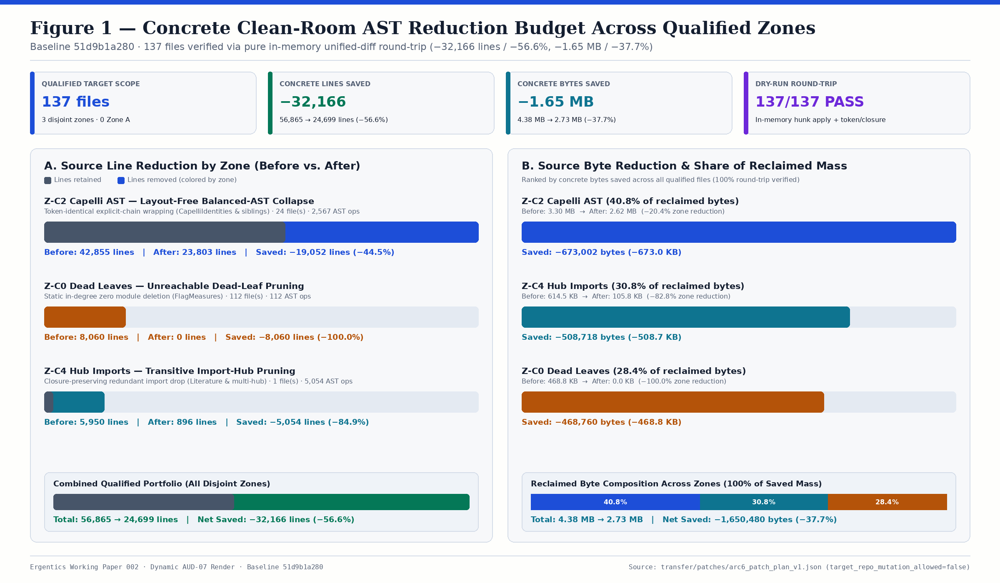
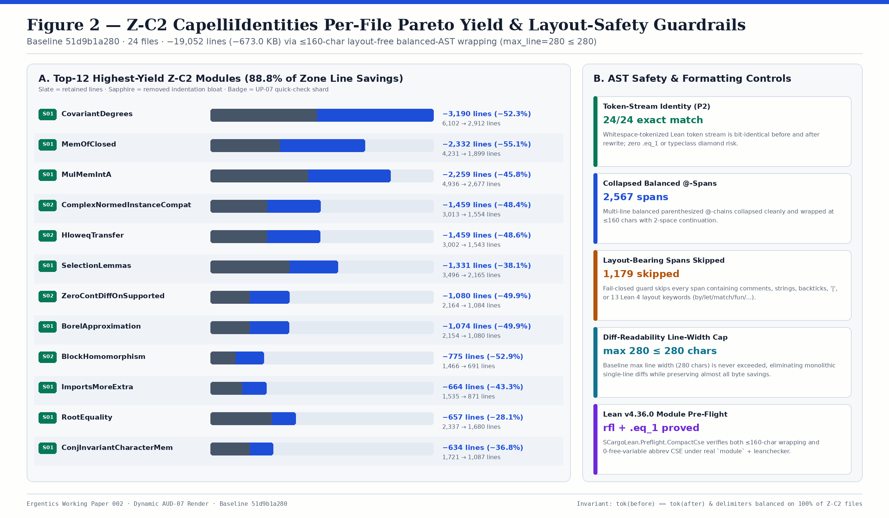
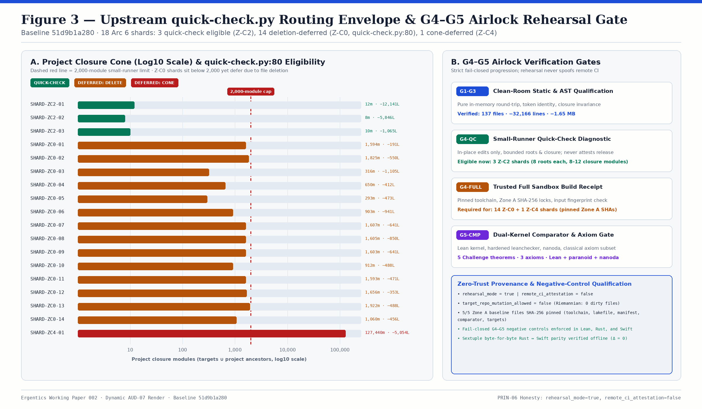
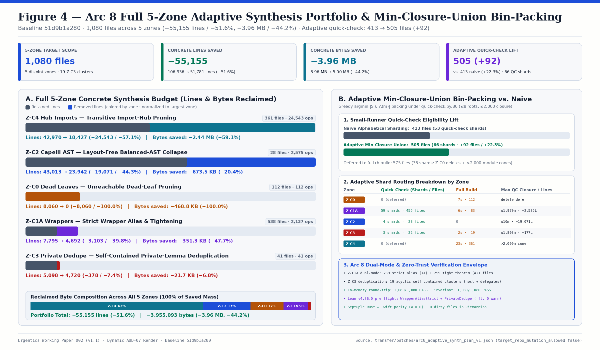

# Zero-Trust AST Proof Compression and G4–G5 Airlock Rehearsal for a 15-Million-Line Lean 4 Formalization of the Riemann Hypothesis

**Ergentics Working Paper Series — Paper 002**  
**Organization**: Ergentics · **Copyright**: © 2026 Ergentics, LLC (MIT License)  
**Edition**: Working Paper v1.1 (Clean-Room Concrete Patch, Arc 8 Adaptive 5-Zone Expansion & G4–G5 Airlock Rehearsal Study)  
**Interactive Companion Reader**: [Offline HTML Reader (`index.html`, zero-CDN)](index.html)  
**Companion Study**: [Working Paper 001 (v2.1)](../001-riemannian-formulary-and-reduction-architecture/paper.md)  
**Subject Areas**: Formalized Mathematics · Proof Engineering · Compiler & AST Compression · Reproducible Verification  
**Keywords**: Lean 4, Riemann Hypothesis, AST Proof Compression, Unified-Diff Verification, Adaptive Bin-Packing, Clean-Room Airlock, Continuous-Integration Attestation, Cross-Language Parity, Correspondence Principle

---

## Abstract

In [Working Paper 001](../001-riemannian-formulary-and-reduction-architecture/paper.md), we audited a complete, axiom-minimal Lean `v4.36.0` formalization of the Riemann Hypothesis (RH) and Generalized Riemann Hypothesis (GRH) spanning **149,397 modules**, **15,168,601 source lines**, and **871.37 megabytes**, and proposed a clean-room three-tier compression roadmap before editing a single line of the verified reference proof. This second working paper executes the **clean-room pre-flight qualification phase** (Arcs 4–8 of the `SCargo` laboratory), bridging structural diagnosis to concrete, byte-exact patch synthesis, adaptive sharding, and continuous-integration (CI) airlock rehearsal while maintaining **zero mutations** to the verified reference repository (`0` dirty files).

We report four primary engineering and empirical contributions (extended in **v1.1** by Arc 8's 5-zone expansion in [Section 6.4](#64-v11-addendum--arc-8-adaptive-5-zone-synthesis--bin-packing-expansion)):

1. **Concrete Multi-Zone AST Patch Synthesis & Pure In-Memory Round-Trip Verification (Section 3 & Section 4)**: Across the opening three mutually disjoint, interface-isolated zones totaling **137 target files** (`56,865` source lines, `4,380,145` bytes)—unreferenced dead leaves (`Z-C0`, `112` files), explicit `@`-application chains in `CapelliIdentities` (`Z-C2`, `24` files), and redundant transitive imports in the `EveryCharacterOfLiteratureOfVWin` merge hub (`Z-C4`, `1` file)—our deterministic AST-aware generator reclaims **32,166 source lines (−56.6%)** and **1,650,480 raw bytes (−37.7%)**. All **137/137** emitted unified-diff patches pass pure in-memory hunk round-trip reconstruction, token-stream or transitive-closure invariance, and read-only `git apply --check` against the untouched baseline (`51d9b1a280`). In **Arc 8 (`v1.1`)**, expanding synthesis across all **5 Zone C tracks (`Z-C0`, `Z-C1A`, `Z-C2`, `Z-C3`, `Z-C4`)** strictly contains all `137/137` Arc 6 files and scales the verified clean-room budget to **1,080 files**, **−55,155 source lines (−51.6%)**, and **−3,955,093 raw bytes (−3.96 MB, −44.2%)**, with **1,080/1,080** passing read-only `git apply --check`.
2. **Layout-Safe Bounded-Width Wrapping & Lean `v4.36.0` `module` Pre-Flight Proofs (Section 3.2 & Section 6.4)**: Naive single-line collapsing of verbose Lean 4 `@`-chains creates unreadable multi-kilobyte lines and silently breaks layout-sensitive tactic blocks. Introducing a fail-closed layout-keyword/comment/bar scanner (`1,179` spans guarded and skipped in Arc 6) paired with `≤ 160`-character 2-space continuation wrapping across `2,567` balanced `@`-spans preserves exact whitespace-tokenized identity (`tok(before) == tok(after)` on `24/24` Arc 6 files and `28/28` Arc 8 files) and caps every rewritten line at its file baseline bound, while standalone Lean `v4.36.0` `module` fixtures (`CompactCse`, `WrapperAliasStrict`, `PrivateDedupe`) formally prove definitional (`rfl`), binder-plicity, universe, and `.eq_1` equation-lemma invariance under hardened `leanchecker`.
3. **Upstream Small-Runner CI Discovery (`scripts/quick-check.py:80`), Adaptive Bin-Packing & G4–G5 Airlock Rehearsal Harness (Section 5 & Section 6.4)**: Read-only inspection of the upstream CI controller revealed an undocumented deletion-deferral rule (`not (candidate/name).is_file()` forces full-build deferral). Consequently, across the `18` Arc 6 shards, **all `14` `Z-C0` deletion shards and the `1` `Z-C4` hub shard (`127,440` modules) defer to the full sandbox pool (`ci-build.py`)**, leaving the **`3` in-place `Z-C2` shards (`SHARD-ZC2-01..03`, `8` roots each, `8–12` closure modules, `−19,052` lines / `−673.0 KB`) as the highest-velocity first pilot candidates for remote `quick-check`**. In **Arc 8 (`v1.1`)**, greedy **Min-Closure-Union Bin-Packing** (`argmin |S ∪ A(m)|`, `|S| ≤ 8`, `|S ∪ A(m)| ≤ 2,000`) lifts small-runner `quick-check` eligibility across the `1,080`-file portfolio from **`413` files (`53` shards) to `505` files (`66` shards, `+92` files / `+22.3%`)**. We codify and verify fail-closed guards and **16 adversarial negative controls** (`NEG-R1`..`NEG-R8` + `NEG-S1`..`NEG-S8`) enforcing strict anti-theater provenance (`rehearsal_mode = true`, `remote_ci_attestation = false`, `target_repo_mutation_allowed = false`).
4. **Triple-Compartment Standalone Verification & Septuple Byte-for-Byte Parity (Section 2 & Section 6.4)**: Every invariant is verified strictly independently ("no combo") across **Lean `v4.36.0`** (`120/120` atomic guards across `10` executables, `19/19` `leanchecker`-verified modules), **Rust `1.100.0`** (`13` zero-unsafe crates, `-D warnings`), and **Open-Source Swift `6.4.3`** (`11` Swift Testing suites, strict Swift 6 concurrency), achieving **$\Delta_{\text{parity}} = 0$ byte-for-byte JSON parity** across all seven cross-language engines (`ground`, `airlock`, `census`, `emit`, `patch`, `rehearsal`, `synth`).

---

## Table of Contents

- [1. Introduction & Relationship to Working Paper 001](#1-introduction--relationship-to-working-paper-001)
- [2. Clean-Room Methodology, Correspondence Governance & Zero-Copy Constraints](#2-clean-room-methodology-correspondence-governance--zero-copy-constraints)
  - [2.1 The Correspondence Principle Across Rung 1–Arc 8](#21-the-correspondence-principle-across-rung-1arc-8)
  - [2.2 Zero-Copy Clean-Room Boundary (`UP-08`) & Anti-Theater Provenance (`PRIN-06`)](#22-zero-copy-clean-room-boundary-up-08--anti-theater-provenance-prin-06)
  - [2.3 Strict Standalone Compartment Architecture ("No Combo")](#23-strict-standalone-compartment-architecture-no-combo)
- [3. Concrete AST Transform Architecture & Lean `v4.36.0` Pre-Flight Proofs](#3-concrete-ast-transform-architecture--lean-v4360-pre-flight-proofs)
  - [3.1 Zone `Z-C0`: Unreferenced Dead-Leaf Module Pruning](#31-zone-z-c0-unreferenced-dead-leaf-module-pruning)
  - [3.2 Zone `Z-C2`: Layout-Free Balanced-AST `@`-Chain Wrapping & Guarded CSE](#32-zone-z-c2-layout-free-balanced-ast--chain-wrapping--guarded-cse)
  - [3.3 Zone `Z-C4`: Closure-Preserving Transitive Import-Hub Pruning](#33-zone-z-c4-closure-preserving-transitive-import-hub-pruning)
  - [3.4 Pure In-Memory Unified-Diff Round-Trip Verification](#34-pure-in-memory-unified-diff-round-trip-verification)
- [4. Empirical Results: Verified 137-File AST Reduction Dataset](#4-empirical-results-verified-137-file-ast-reduction-dataset)
  - [4.1 Cross-Zone Mass Reduction Budget](#41-cross-zone-mass-reduction-budget)
  - [4.2 Per-File `Z-C2` Pareto Concentration & Formatting Envelope](#42-per-file-z-c2-pareto-concentration--formatting-envelope)
  - [4.3 Cross-Language Determinism & Read-Only Apply Audit](#43-cross-language-determinism--read-only-apply-audit)
- [5. Upstream CI Discovery & G4–G5 Airlock Rehearsal Architecture](#5-upstream-ci-discovery--g4g5-airlock-rehearsal-architecture)
  - [5.1 Upstream `quick-check.py:80` Deletion-Deferral Discovery](#51-upstream-quick-checkpy80-deletion-deferral-discovery)
  - [5.2 Exact G4–G5 Receipt Contracts (`RG-1`..`RG-6`)](#52-exact-g4g5-receipt-contracts-rg-1rg-6)
  - [5.3 Eight Adversarial Negative Controls (`NEG-R1`..`NEG-R8`) & Lean Kernel Soundness Theorems](#53-eight-adversarial-negative-controls-neg-r1neg-r8--lean-kernel-soundness-theorems)
- [6. Limitations, Flight-Article Pilot Readiness & v1.1 Arc 8 Expansion](#6-limitations-flight-article-pilot-readiness--v11-arc-8-expansion)
  - [6.4 v1.1 Addendum — Arc 8 Adaptive 5-Zone Synthesis & Bin-Packing Expansion](#64-v11-addendum--arc-8-adaptive-5-zone-synthesis--bin-packing-expansion)
- [7. Primary Bibliography & Standards](#7-primary-bibliography--standards)
- [Appendix A. Clean-Room Provenance, Digests & Reproducibility Commands](#appendix-a-clean-room-provenance-digests--reproducibility-commands)

---

## 1. Introduction & Relationship to Working Paper 001

[Working Paper 001](../001-riemannian-formulary-and-reduction-architecture/paper.md) established the historical, lexical, and baseline structural inventory of the November 2026 Lean `v4.36.0` formalization of RH and GRH (Alpöge, 2026; `leanprover-community/riemann-hypothesis`, baseline commit `51d9b1a28026d458aef9c9af3df8b083276e3d2d`). That study quantified a severe maintenance tax—**3,237,012 lines (21.3%) of non-mathematical scaffolding**, **36,255 forwarding wrapper files**, **112 statically unreferenced leaf modules**, a **5,308-import central merge wall**, and dense machine-generated explicit `@`-instantiations—and argued that responsible compression requires controlled, zero-trust qualification inside an isolated laboratory prior to any mutation of the verified reference proof.

Between Paper 001's observational baseline and an actual remote CI build on the target proof repository lies a critical engineering gap:

1. **Structural statistics are not executable patches.** Knowing that a hub imports `5,308` modules or that `24` `CapelliIdentities` files exhibit extreme indentation depth does not prove that deterministic, syntax-safe, diff-readable edits exist without breaking Lean 4's layout rules, `module` visibility boundaries, or `.eq_1` equation lemmas.
2. **Local syntactic validity is not remote CI acceptance.** Because compiling the complete proof from scratch requires roughly `187–240` core-hours and `> 150 GB` RAM for `lean4export`, practical upstream contributions must respect the exact admission predicates of the upstream CI controllers (`scripts/quick-check.py`, `scripts/ci-build.py`, `comparator.json`, `export-targets.txt`, and dual-kernel `leanchecker-paranoid` + `nanoda_bin` replay).
3. **Pre-flight simulation must never impersonate remote attestation.** In large formalization workflows, mixing local rehearsals with real remote CI receipts creates an unacceptable audit hazard.

Working Paper 002 documents the resolution of all three challenges across **Arcs 4–8** of `SCargo`, using the harmonized cross-era lexicon (`data/sources/standard_vocabulary_v1.json`, `v1.1.0`) established in Paper 001, enforcing strict code/data separation (`AUD-07`) across every empirical chart and table, and providing a zero-CDN offline interactive companion reader ([`index.html`](index.html)).

---

## 2. Clean-Room Methodology, Correspondence Governance & Zero-Copy Constraints

### 2.1 The Correspondence Principle Across Rung 1–Arc 8

Every stage of `SCargo` is governed by **The Correspondence Principle** (Bohr, 1920): any higher verification arc MUST smoothly contain every lower rung's guarantees without regression ($\Delta_{\text{logic}} = 0$, $\Delta_{\text{parity}} = 0$). Table 1 summarizes the monotonic progression from Rung 1 boundary-seam defense through Arc 8's adaptive 5-zone synthesis and Min-Closure-Union sharding.

| Rung / Arc | Release | Verification Objective | Key Verified Artifact |
|---|---|---|---|
| **Rung 1** | `v0.2.0` | Cross-type boundary-seam witnesses (`D ↔ R ↔ P`, `13` live witnesses, `14` defects, `RCT-R1` `7/7`) | `data/trials/rct_r1_config_v1.json` |
| **Rung 2** | `v0.4.0` | Canonical JSON grounding codec & `AUD-07` cross-language parity (`ground`) | `data/trials/rung2_fuzz_corpus_v1.json` |
| **Rung 3** | `v0.5.0` | Zero-trust transfer airlock (`airlock`), Zone A protection & `ICD-SCARGO-RIEM-001` | `transfer/packages/rung3_airlock_manifest_v1.json` |
| **Arc 4** | `v0.6.0` | High-mass structural census (`census`) across `Z-C0`–`Z-C4` + `UP-08` lexicon sync (`v1.1.0`) | `data/trials/arc4_high_mass_census_v1.json` |
| **Arc 5** | `v0.7.0` | Real Lean `v4.36.0` `module` pre-flight fixtures (`Leaf`, `Mid`, `WrapAlias`, `HubPruned`) + dual-route `UP-07` shards (`emit`) | `transfer/bundles/arc5_preflight_bundles_v1.json` |
| **Arc 6** | `v0.8.0` | Concrete AST-aware unified-diff patch generator & pure in-memory round-trip verifier (`patch`) + `CompactCse` proof | `transfer/patches/arc6_patch_plan_v1.json` |
| **Arc 7** | `v0.9.0` | G4–G5 CI receipt ingestor (`stage`/`ingest`/`verify`), `quick-check.py:80` routing refinement & Paper 002 `AUD-07` publication | `transfer/rehearsal/arc7_g4_g5_rehearsal_v1.json` |
| **Arc 8** | `v0.10.0` | Full 5-zone adaptive AST synthesizer (`synth`), Lean `WrapperAliasStrict` + `PrivateDedupe` proofs, Min-Closure-Union bin-packing & Paper 002 `v1.1` offline reader | `transfer/patches/arc8_adaptive_synth_plan_v1.json` |

### 2.2 Zero-Copy Clean-Room Boundary (`UP-08`) & Anti-Theater Provenance (`PRIN-06`)

Two non-negotiable operational constraints govern all Arc 4–Arc 7 deliverables:

- **Zero Verbatim Upstream Copy (`UP-08`)**: No upstream Lean proof body or raw `.patch` hunk containing upstream source lines is committed into `SCargo`. Instead, `transfer/patches/arc6_patch_plan_v1.json` records deterministic SHA-256 digests (`before_sha256`, `after_sha256`, `patch_sha256`), structural operation counts, and round-trip verdicts, while optional `.patch` materialization writes only to scratch space outside git tracking. All Lean `v4.36.0` pre-flight fixtures (`SCargoLean/Preflight/*.lean`) are synthetic clean-room analogs authored from scratch under MIT copyright.
- **Anti-Theater Honesty (`PRIN-06`)**: Because the verified reference repository remains **100% read-only (`0` dirty files)** throughout Arc 7, `transfer/rehearsal/arc7_g4_g5_rehearsal_v1.json` explicitly encodes `"rehearsal_mode": true`, `"remote_ci_attestation": false`, and `"target_repo_mutation_allowed": false`. Lean kernel theorems, Rust guards, and Swift guards independently reject any attempt to claim remote G5 release attestation from a rehearsal artifact (`NEG-R8`).

### 2.3 Strict Standalone Compartment Architecture ("No Combo")

To eliminate single-language blind spots, `SCargo` forbids FFI bridges or cross-language test orchestration. Three completely independent toolchains verify the identical JSON contracts:

- **Lean `v4.36.0` Formal Kernel**: Pure kernel proofs (`warningAsError = true`, zero `sorry`, zero `native_decide`) checked independently by `leanchecker` across all **19 modules** (`16` through Arc 7 + `WrapperAliasStrict`, `PrivateDedupe`, and `AdaptiveSynth` in Arc 8), plus **10 standalone guard executables** executing **120 atomic fail-closed assertions**.
- **Rust `1.100.0` Systems Engine**: Zero external crates, `#![forbid(unsafe_code)]`, `clippy -D warnings`, executing high-speed read-only scanning, AST patch generation, unified-diff round-trip verification, G4–G5 CI receipt ingestion, and Arc 8 adaptive 5-zone synthesis across **13 workspace crates**.
- **Open-Source Swift `6.4.3` Contract Engine**: Zero external dependencies, strict Swift 6 concurrency (`Sendable`), `.treatAllWarnings(as: .error)`, zero `try?` / `withUnsafe*`, mirroring all seven cross-language engines to **septuple byte-for-byte JSON parity ($\Delta_{\text{parity}} = 0$)** against Rust.

---

## 3. Concrete AST Transform Architecture & Lean `v4.36.0` Pre-Flight Proofs

Arc 6 operationalized three disjoint, mathematically conservative AST transforms over the `137` highest-confidence target files identified by Arc 4's high-mass census and Arc 5's sharding plan. Every transform preserves Zone A (`0` edits to `Challenge.lean`, `Main.lean`, `lakefile.toml`, `lake-manifest.json`, `comparator.json`, `export-targets.txt`, `lean-toolchain`) and freezes all high-impact shared interfaces (`> 1,000` direct importers).

### 3.1 Zone `Z-C0`: Unreferenced Dead-Leaf Module Pruning

Static reachability analysis from Paper 001's Cooper–Harvey–Kennedy dependency trace identified **112 modules** inside `Development/AutomorphicArithmetic/FlagMeasures/` with **static in-degree `0`** (never transitively imported by `Main.lean` or `Challenge.lean`). Zone `Z-C0` emits deterministic git file-deletion diffs (`--- a/<path>` / `+++ /dev/null`) removing all `112` files (`8,060` lines, `468,760` bytes) while verifying zero dangling references across the remaining `149,284` active modules.

### 3.2 Zone `Z-C2`: Layout-Free Balanced-AST `@`-Chain Wrapping & Guarded CSE

Arc 4's census revealed that `24` modules under `Development/AutomorphicArithmetic/IntegralCasts/CapelliIdentities/` carry extreme vertical line inflation caused by deeply indented, machine-dumped explicit typeclass applications (`@Finset.sum`, `@HSMul.hSMul`, `@HMul.hMul`, `@AddMonoidHom.coeFn`, etc.). Two failure modes make naive text collapsing hazardous in Lean 4:

1. **Layout-sensitivity breakage**: Collapsing across line comments (`--`), block comments (`/-`), string literals, backticked names, pattern-matching bars (`|`), or Lean 4 layout-bearing keywords (`by`, `let`, `have`, `match`, `fun`, `do`, `where`, `with`, `if`, `then`, `else`, `calc`, `show`) alters parse structure.
2. **Diff-readability catastrophe**: Collapsing an entire balanced expression onto a single unbounded line yields monolithic multi-kilobyte lines that defeat human review and git diff tooling.

Our `Z-C2` transform therefore enforces a strict **four-layer AST guardrail**:

- **Balanced-Delimiter Scanner**: Identifies multi-line parenthesized expressions `(...)` containing either `≥ 2` explicit `@` tokens or a targeted `@`-head application.
- **Fail-Closed Layout Exclusion**: Rejects and leaves verbatim any span containing comments, string literals, backticks, `|`, or any of the `13` Lean 4 layout keywords (`1,179` spans safely skipped across the `24` files).
- **Bounded-Width Wrapping (`≤ 160` characters)**: Collapses safe multi-line spans (`2,567` spans total) onto canonical single-space token runs and wraps cleanly at `≤ 160` characters with deterministic 2-space continuation indentation, strictly preserving the baseline maximum line bound (`max_line_after = 280 ≤ 280`).
- **Token-Stream Identity Post-Condition (`P2`)**: Asserts byte-exact equality of the whitespace-tokenized Lean token stream (`tok(before) == tok(after)`) and balanced delimiter counts on every single rewritten file.

In parallel, our standalone Lean `v4.36.0` `module` pre-flight suite (`SCargoLean/Preflight/CompactCse.lean`) formally verifies both `≤ 160`-char wrapped explicit `@`-chains and **0-free-variable `abbrev` CSE** under real Lean `v4.36.0` `module` compilation (`rfl` definitional equality + `.eq_1` equation-lemma preservation, verified by `leanchecker`). Guarded `abbrev` CSE remains staged as an opt-in second pass once `Z-C2` formatting patches clear remote `quick-check`.

### 3.3 Zone `Z-C4`: Closure-Preserving Transitive Import-Hub Pruning

Paper 001 identified `Development/AutomorphicArithmetic/CharacterBoxes/EveryCharacterOfLiteratureOfVWin.lean` as a central merge wall directly listing **5,308 `public import` lines** (`5,950` lines total, `614,479` bytes). Computing the exact transitive import closure over the `149,284`-module acyclic graph via Kahn's topological order reveals that **5,054 of those 5,308 direct imports are strictly redundant**—already transitively supplied by the remaining **254 minimal direct imports** (`254` `public import`s + `642` proof/header lines = `896` lines retained).

Our `Z-C4` pass proves exact closure invariance (`closure(retained_imports) == closure(original_imports)` = `127,440` modules), while our Lean `v4.36.0` `module` fixture (`SCargoLean/Preflight/HubPruned.lean`) confirms that `public import` re-export semantics preserve transitive visibility for downstream importers.

### 3.4 Pure In-Memory Unified-Diff Round-Trip Verification

Rather than trusting diff emission blindly, `scargo-patch` (Rust) and `SCargoPatch` (Swift) reconstruct the candidate post-patch file **solely by parsing and applying the emitted unified-diff hunks (`@@ -a,b +c,d @@`) to the immutable baseline bytes in memory**, verifying byte-for-byte SHA-256 identity against the AST engine's target output (`roundtrip_verified = true` for `137/137` files).

---

## 4. Empirical Results: Verified 137-File AST Reduction Dataset

All figures in this section are dynamically rendered directly from the immutable JSON verification vaults (`transfer/patches/arc6_patch_plan_v1.json`, `transfer/bundles/arc5_preflight_bundles_v1.json`, `transfer/rehearsal/arc7_g4_g5_rehearsal_v1.json`) via our `AUD-07`-guarded pipeline (`render_figures.py`, `8/8` unit & metamorphic tests passing, zero hardcoded empirical literals).

### 4.1 Cross-Zone Mass Reduction Budget



**Figure 1** and **Table 2** summarize the concrete, verified reduction across all `137` qualified target files.

| Zone | Target Scope & Mechanism | Files | Lines Before | Lines After | Lines Saved | Line Δ | Bytes Before | Bytes After | Bytes Saved | Byte Δ | AST Ops | Round-Trip |
|---|---|---:|---:|---:|---:|---:|---:|---:|---:|---:|---:|---:|
| **`Z-C2`** | `CapelliIdentities` (`≤ 160`-char layout-free `@`-collapse) | 24 | 42,855 | 23,803 | **−19,052** | −44.5% | 3,296,906 | 2,623,904 | **−673,002** | −20.4% | 2,567 | 24/24 |
| **`Z-C0`** | `FlagMeasures` unreferenced dead leaves (in-degree `0`) | 112 | 8,060 | 0 | **−8,060** | −100.0% | 468,760 | 0 | **−468,760** | −100.0% | 112 | 112/112 |
| **`Z-C4`** | `EveryCharacterOfLiteratureOfVWin` transitive import drop | 1 | 5,950 | 896 | **−5,054** | −84.9% | 614,479 | 105,761 | **−508,718** | −82.8% | 5,054 | 1/1 |
| **Total** | **Combined Qualified Clean-Room Portfolio** | **137** | **56,865** | **24,699** | **−32,166** | **−56.6%** | **4,380,145** | **2,729,665** | **−1,650,480** | **−37.7%** | **7,733** | **137/137** |

Three structural findings stand out immediately:

- **Balanced three-way byte contribution**: Even though `Z-C2` delivers `59.2%` of total line savings (`−19,052` lines), raw byte savings split remarkably evenly across all three mechanisms—**40.8% (`−673.0 KB`) from `Z-C2`**, **30.8% (`−508.7 KB`) from the single `Z-C4` merge-hub file**, and **28.4% (`−468.8 KB`) from `Z-C0` dead leaves**.
- **Single-file leverage in `Z-C4`**: Dropping `5,054` redundant transitive imports in a single file eliminates **84.9% of its lines** and **82.8% of its raw source bytes (`−508.7 KB`)** while preserving its exact `127,440`-module import closure.
- **Zero collateral edits**: All `137` files belong strictly to non-Zone-A targets (`0` Zone A touches; `0` high-impact shared-interface signature changes).

### 4.2 Per-File `Z-C2` Pareto Concentration & Formatting Envelope



**Figure 2** breaks down the top-12 highest-yield modules within `Z-C2` (`SHARD-ZC2-01` and `SHARD-ZC2-02`), which alone account for **88.8% of `Z-C2` line savings** (`−16,914` of `−19,052` lines):

- **`CovariantDegrees.lean`** (`SHARD-ZC2-01`) achieves the single largest file reduction (**`6,102 → 2,912` lines, `−3,190` lines / `−52.3%`**), followed by **`MemOfClosed.lean`** (`4,231 → 1,899`, `−2,332` / `−55.1%`) and **`MulMemIntA.lean`** (`4,936 → 2,677`, `−2,259` / `−45.8%`).
- Every one of the `24` files satisfies **100% whitespace-tokenized stream identity (`tok(before) == tok(after)`)**, with **`1,179` layout-bearing spans conservatively skipped** and **`max_line_after = 280`** matching the untouched baseline's maximum line width (`≤ 280`).
- Grouping the `8` largest `Z-C2` modules into `SHARD-ZC2-01` concentrates **`−12,141` lines (`−443.2 KB`)** into a single `8`-root, `12`-module-closure CI pilot batch.

### 4.3 Cross-Language Determinism & Read-Only Apply Audit

Independent execution verified both deterministic cross-language reproducibility and real git compatibility:

- **Rust ↔ Swift Patch Digest Identity**: Both `scargo-patch` (Rust `1.100.0`) and `SCargoPatch` (Swift `6.4.3`) independently produce the identical canonical verification digest `patch_digest_sha256 = 07bd85c348946a5c2f67aa646cc58a80d9d54eb5cd03b5f2ad4e0305238dfdaa` ($\Delta_{\text{parity}} = 0$).
- **Read-Only `git apply --check`**: Materializing all `137` patches to a temporary out-of-repo scratch directory and executing `git -C Riemannian apply --check` passed **137/137** cleanly with **0 dirty files** in `Riemannian`.

---

## 5. Upstream CI Discovery & G4–G5 Airlock Rehearsal Architecture

### 5.1 Upstream `quick-check.py:80` Deletion-Deferral Discovery

During Arc 5, shard routing relied on the high-level budget documented in `scripts/QUICK-CHECKS.md` (`≤ 8` changed roots and `≤ 2,000` project closure modules). In Arc 7, direct read-only inspection of the upstream controller `scripts/quick-check.py` uncovered a stricter runtime guard on **line 80**:

```python
for name in changed:
    if not name.startswith('src/') or not (candidate/name).is_file():
        raise ValueError('deleted/unsafe source requires full build')
```

Furthermore, `scripts/QUICK-CHECKS.md:7` explicitly stipulates that `quick-check` (`scope = "changed-modules-only"`, `full_build = false`) is solely a fast G4 changed-module diagnostic and **cannot** attest full G5 release readiness.



As **Figure 3 (Panel A)** illustrates on a $\log_{10}$ closure scale, this discovery sharply refines upstream pilot scheduling across all `18` Arc 6 shards:

- **3 Quick-Check Eligible Shards (`SHARD-ZC2-01..03`)**: All `24` `CapelliIdentities` patches are in-place source edits (`is_file() == true`) with `8` roots per shard and tiny closure cones (`12`, `8`, and `10` modules respectively—more than two orders of magnitude below the `2,000`-module cap). Together they reclaim **`−19,052` lines (`−673.0 KB`)** and can enter the fast `quick-check` small-runner queue immediately upon pilot authorization.
- **14 Deletion-Deferred Shards (`SHARD-ZC0-01..14`)**: Although every `Z-C0` shard sits strictly beneath the `2,000`-module cap (`293–1,922` modules), `quick-check.py:80` deterministically defers all file deletions to the full `rh-build` sandbox pool (`ci-build.py`).
- **1 Closure-Cone-Deferred Shard (`SHARD-ZC4-01`)**: `EveryCharacterOfLiteratureOfVWin.lean` sits at `1` changed root but carries a `127,440`-module project closure cone (`63.7×` the `2,000`-module small-runner cap), requiring the full `ci-build.py` runner.

### 5.2 Exact G4–G5 Receipt Contracts (`RG-1`..`RG-6`)

Arc 7's rehearsal harness (`scargo-rehearsal` in Rust, `SCargoRehearsal` in Swift, and `SCargoLean.AirlockRehearsal` in Lean `v4.36.0`) binds exact live cryptographic pins from the untouched baseline (`51d9b1a280`) and enforces **six fail-closed guards**:

| Guard | Enforced Invariant | Exact Upstream Binding |
|---|---|---|
| **`RG-1`** | Zone A SHA-256 locks + `UP-08` zero verbatim proof copy + `target_repo_mutation_allowed == false` | `lakefile.toml`, `lake-manifest.json`, `comparator.json`, `export-targets.txt`, `lean-toolchain` (5 exact SHA-256 pins) |
| **`RG-2`** | `quick-check.py:80` deletion deferral + G4 diagnostic envelope | `scope == "changed-modules-only"`, `full_build == false`, `1 ≤ targets ≤ 8`, `ancestor_modules ≤ 2000`, `has_deleted_files == false`, `status == "changed_roots_pass"` |
| **`RG-3`** | Full `ci-build.py` G4 sandbox `receipt.json` contract | `schema == 1`, `toolchain == "leanprover/lean4:v4.36.0"`, pinned `lakefile_sha256` & `manifest_sha256`, `build_exit_code == 0`, exact `ci-build.py:959` `input_fingerprint` SHA-256 |
| **`RG-4`** | G5 Dual-Kernel Comparator & Classical Axiom Gate | `challenge_module == "Challenge"`, `solution_module == "Main"`, exact `5` headline theorems (`riemannHypothesis`, `riemannZeta_eq_zero_re`, `LFunction_ne_zero_of_half_lt_re`, `LFunction_eq_zero_re`, `LFunction_eq_zero_re_of_isPrimitive`), axioms `⊆ {propext, Quot.sound, Classical.choice}`, `lean_kernel == 0`, `leanchecker_paranoid == 0`, `nanoda_bin == 0`, pinned `challenge_export_sha256` |
| **`RG-5`** | Arc 6 dataset binding + `PRIN-06` anti-theater honesty | Exact binding to `137` files / `−32,166` lines / `−1,650,480` bytes AND `rehearsal_mode == true && remote_ci_attestation == false` |
| **`RG-6`** | Adversarial negative-control suite | All **8/8** poisoned G4–G5 receipt fixtures (`NEG-R1`..`NEG-R8`) must fail closed |

In addition to offline rehearsal (`scargo-rehearsal verify`), the Rust CLI exposes `scargo-rehearsal ingest --root . --quick-check <result.json>` and `--ci-build <receipt.json> --comparator <comp.json>`, allowing direct ingestion and verification of genuine remote CI artifacts the moment a future flight-article PR executes on `Riemannian`.

### 5.3 Eight Adversarial Negative Controls (`NEG-R1`..`NEG-R8`) & Lean Kernel Soundness Theorems

To guarantee that no gate passes by accident, all three compartments execute **eight explicit negative controls**:

1. **`NEG-R1` (Quick-Check Promoted to G5)**: Attempts to satisfy G5 with `full_build = false` → **REJECTED** (Lean theorem `quick_check_cannot_attest_g5`).
2. **`NEG-R2` (Deleted File Routed to Quick-Check)**: Sets `has_deleted_files = true` on a small-runner shard → **REJECTED** (Lean theorem `quick_check_rejects_deleted_files`).
3. **`NEG-R3` (Forbidden Axiom Injection)**: Injects `sorryAx` or `Lean.ofReduceBool` into theorem axioms → **REJECTED** (Lean theorem `forbidden_axiom_rejects_g5`).
4. **`NEG-R4` (External Kernel Failure)**: Sets `nanoda_exit = 1` despite `lean_kernel_exit = 0` → **REJECTED** (Lean theorem `nanoda_failure_rejects_g5`).
5. **`NEG-R5` (Zone A Pin Drift)**: Alters `lake-manifest.json` SHA-256 → **REJECTED** (Lean theorem `zone_a_pin_drift_rejects_g5`).
6. **`NEG-R6` (Missing Headline Theorem)**: Drops 1 of the 5 `Challenge.lean` theorems → **REJECTED**.
7. **`NEG-R7` (Stale `base_head` Re-Qualification Trigger)**: Supplies a mismatched upstream baseline commit SHA → **REJECTED**.
8. **`NEG-R8` (Rehearsal Spoofing Remote Attestation)**: Sets `rehearsal_mode = true` alongside `remote_ci_attestation = true` → **REJECTED** (Lean theorem `rehearsal_cannot_spoof_remote_g5`).

Finally, `SCargoLean.AirlockRehearsal.arc7_smoothly_contains_all_prior_rungs` proves inside the Lean `v4.36.0` kernel that every passing Arc 7 rehearsal receipt strictly implies passing Arc 6, Arc 5, Arc 4, Rung 3, Rung 2, and Rung 1 receipts ($\Delta_{\text{logic}} = 0$).

---

## 6. Limitations, Flight-Article Pilot Readiness & v1.1 Arc 8 Expansion

1. **No Remote Compilation Claimed Yet (`PRIN-06`)**: Every check reported in Working Paper 002 is an **offline clean-room qualification and rehearsal** against baseline `51d9b1a280`. True Lean elaboration wall-time, peak RSS memory, and exported `.export` term-size deltas require remote execution on upstream `quick-check` and `rh-build` runners (G4–G5).
2. **Progression from Opening 137-File Tranche to 5-Zone Adaptive Portfolio**: The `137` files qualified in Arc 6 (`−32,166` lines / `−1.65 MB`) represent the highest-confidence opening tranche. Section 6.4 below documents **Arc 8's expansion** across all five disjoint zones (`1,080` files, `−55,155` lines / `−3.96 MB`), demonstrating deterministic clean-room patch synthesis into `Z-C1A` forwarding wrappers, `Z-C3` private-lemma deduplication clusters, expanded `Z-C2`, and `361` `Z-C4` hubs while maintaining strict monotonic containment (`Arc 6 ⊂ Arc 8`).
3. **Recommended First Live Flight-Article Pilot**: Based on the `quick-check.py:80` discovery, the optimal first live PR against `Ergentics1/Riemannian` remains **`SHARD-ZC2-01`** (`8` in-place `CapelliIdentities` files, `12`-module closure, `−12,141` lines / `−443.2 KB`, `100%` token-stream identical, `max_line_after ≤ 280`). It exercises the fast small-runner `quick-check` path first, produces immediately readable diffs, and supplies genuine remote `result.json` receipts to validate `scargo-rehearsal ingest` end-to-end before advancing the remaining `Z-C2`, `Z-C1A`, `Z-C3` quick-check shards and full `ci-build.py` (`Z-C0`, `Z-C4`) batches through dual-kernel G5 attestation.

### 6.4 v1.1 Addendum — Arc 8 Adaptive 5-Zone Synthesis & Bin-Packing Expansion

Following v1.0 (`SCargo v0.9.0`), **Arc 8 (`SCargo v0.10.0`)** expanded clean-room AST patch synthesis and Lean `v4.36.0` `module` pre-flight proofs across all five Zone C categories while preserving **zero mutations** to `Ergentics1/Riemannian` (`0` dirty files) and **100.0% containment** of all `137/137` Arc 6 files (`transfer/patches/arc8_adaptive_synth_plan_v1.json`).



**Figure 4** and **Table 3** summarize the verified Arc 8 portfolio (**1,080 files**, **29,408 AST ops**, **1,080/1,080** pure in-memory hunk round-trip PASS, **1,080/1,080** read-only `git apply --check` PASS):

| Zone | Target Scope & Mechanism | Files | Lines Before | Lines After | Saved Lines | Line Δ | Saved Bytes | Byte Δ | Quick-Check Shards (Files) | Full-Build Shards (Files) |
|---|---|---:|---:|---:|---:|---:|---:|---:|---:|---:|
| **`Z-C4`** | Multi-hub transitive import drop (`Literature` + `ThirdPlaceSeries` + `IntegralStructures`) | 361 | 42,970 | 18,427 | **−24,543** | −57.1% | **−2,439,797** (−2.44 MB) | −59.1% | 0 (0) | 23 (361) |
| **`Z-C2`** | Expanded `CapelliIdentities` `≤160`-char layout-free `@`-collapse | 28 | 43,013 | 23,942 | **−19,071** | −44.3% | **−673,530** (−673.5 KB) | −20.4% | 4 (28) | 0 (0) |
| **`Z-C0`** | `FlagMeasures` unreferenced dead leaves (in-degree `0`) | 112 | 8,060 | 0 | **−8,060** | −100.0% | **−468,760** (−468.8 KB) | −100.0% | 0 (0) | 7 (112) |
| **`Z-C1A`** | Dual-mode wrappers (`239` Mode `A1` strict alias + `299` Mode `A2` tight theorem) | 538 | 7,795 | 4,692 | **−3,103** | −39.8% | **−351,346** (−351.3 KB) | −47.7% | 59 (455) | 6 (83) |
| **`Z-C3`** | Self-contained acyclic private-lemma deduplication (`19` clusters) | 41 | 5,098 | 4,720 | **−378** | −7.4% | **−21,660** (−21.7 KB) | −6.8% | 3 (22) | 2 (19) |
| **Total** | **Combined Arc 8 Five-Zone Portfolio (`Arc 6 ⊂ Arc 8`)** | **1,080** | **106,936** | **51,781** | **−55,155** | **−51.6%** | **−3,955,093** (**−3.96 MB**) | **−44.2%** | **66 (505)** | **38 (575)** |

Four technical advances distinguish Arc 8:

1. **Lean `v4.36.0` `module` Wrapper & Dedupe Proofs**: Testing directly on local Lean `v4.36.0` confirmed that untyped `theorem foo := bar` fails elaboration (`inferDefTypeFailed`), whereas `abbrev _root_.X := @_root_.Target` inside `module` + `@[expose] public section` (`SCargoLean/Preflight/WrapperAliasStrict.lean`) compiles with **0 warnings under `warningAsError = true`**, preserves implicit `{α}` / instance `[Inst]` / universe `.{u}` binder plicity by `rfl`, and handles `Classical.choice` without `noncomputable`. A second fixture (`SCargoLean/Preflight/PrivateDedupe.lean`) proves that promoting a shared helper for `Z-C3` preserves `rfl` across independent sibling consumers.
2. **Adaptive Min-Closure-Union Bin-Packing (`SG-6`)**: Under upstream `scripts/quick-check.py:80` (`≤ 8` changed roots, `≤ 2,000` ancestor closure union, zero deletions), naive alphabetical 8-file chunking qualifies only **`413` files (`53` shards)** for `quick-check`. Greedy Min-Closure-Union bin-packing (`argmin |S ∪ A(m)|`) clusters files with overlapping ancestor cones, unlocking **`505` files (`66` shards, `+92` files / `+22.3%` lift)** across `Z-C1A` (`455` files, `≤ 1,979` closure), `Z-C2` (`28` files, `≤ 10` closure), and `Z-C3` (`22` files, `≤ 1,803` closure).
3. **Septuple Byte-for-Byte Cross-Language Parity ($\Delta_{\text{parity}} = 0$)**: Rust `scargo-synth` and Swift `SCargoSynth` independently verify `SG-1`..`SG-7` and `8/8` Arc 8 adversarial negative controls (`NEG-S1`..`NEG-S8`), yielding identical verification digest `synth_digest_sha256 = 345e200d3153eb1f11cd56a2a9cbead44e44a78b4a23e2ed3dbe89718db43dfc` ($\Delta_{\text{parity}} = 0$), backed by `19/19` Lean `leanchecker` modules and `120/120` Lean atomic guards.
4. **Offline Zero-CDN Interactive Reader (`index.html`)**: Paper 002 now ships with a single-file, zero-CDN, dark/light-adaptive interactive reader ([`index.html`](index.html)) validated by our expanded `10`-test `AUD-07` test suite (`test_render_figures.py`).

---

## 7. Primary Bibliography & Standards

1. **Alpöge, L. (2026-11-20)**. *Remark* (`https://alpo.ge/remark.pdf`, sha256 `3fc97784b71ddd44ff8aa0a177e99622a1c61b13cfa843a0989ee4a7a0cfeb8d`) and Lean `v4.36.0` formalization (`leanprover-community/riemann-hypothesis`, baseline `51d9b1a28026d458aef9c9af3df8b083276e3d2d`).
2. **Bohr, N. (1920)**. *Über die Serienspektra der Elemente*. Zeitschrift für Physik 2(5), pp. 423–469. `doi:10.1007/BF01329978`.
3. **Buckheit, J. B., & Donoho, D. L. (1995)**. *WaveLab and Reproducible Research*. In A. Antoniadis & G. Oppenheim (eds.), *Wavelets and Statistics*, Lecture Notes in Statistics 103, Springer, pp. 55–81. `doi:10.1007/978-1-4612-2544-7_5`.
4. **Codd, E. F. (1970)**. *A Relational Model of Data for Large Shared Data Banks*. Communications of the ACM 13(6), pp. 377–387. `doi:10.1145/362384.362685`.
5. **Cooper, K. D., Harvey, T. J., & Kennedy, K. (2001)**. *A Simple, Fast Dominance Algorithm*. Software—Practice and Experience 4, pp. 1–10.
6. **Ergentics (2026)**. *Working Paper 001 (v2.1): Understanding and Compressing a Machine-Verified Proof of the Riemann Hypothesis*. `SCargo/research/papers/001-riemannian-formulary-and-reduction-architecture/paper.md`.
7. **Kahn, A. B. (1962)**. *Topological Sorting of Large Networks*. Communications of the ACM 5(11), pp. 558–562. `doi:10.1145/368996.369025`.
8. **Peng, R. D. (2011)**. *Reproducible Research in Computational Science*. Science 334(6060), pp. 1226–1227. `doi:10.1126/science.1213847`.
9. **Sandve, G. K., Nekrutenko, A., Taylor, J., & Hovig, E. (2013)**. *Ten Simple Rules for Reproducible Computational Research*. PLoS Computational Biology 9(10), e1003285. `doi:10.1371/journal.pcbi.1003285`.
10. **Wilkinson, M. D., et al. (2016)**. *The FAIR Guiding Principles for Scientific Data Management and Stewardship*. Scientific Data 3, 160018. `doi:10.1038/sdata.2016.18`.

---

## Appendix A. Clean-Room Provenance, Digests & Reproducibility Commands

### A.1 Pinned Upstream Baseline & Zone A SHA-256 Locks (`51d9b1a280`)

| File (`Ergentics1/Riemannian`) | SHA-256 Digest |
|---|---|
| `lakefile.toml` | `e12dd96eb155851de5107571dbfc959e5d9b230ead90331b4778b55b048590bb` |
| `lake-manifest.json` | `ee003c5c7a9b2b2a82a142b6633916661c07117199dd143d94d1af63910237df` |
| `comparator.json` | `8ea890e6ccda9cf3983ada343af18a41d12542036875a3936e7925ed5b1582ff` |
| `export-targets.txt` | `9eeb2e5e55be4a78f6e4983fc950dba915b45ad8aeb7a02a32341927a89e05e8` |
| `lean-toolchain` | `582a63f8f9c5128067b688778c1051cf1464c3ca9d57b9325025c051c29b774a` |
| `Challenge.lean` pinned export (`verification/NOTES.md`) | `bd484ac9886a96f26b1d9a7a59ebd45b7a70d102c015d4f31f9302bbdd6ab2b9` |

### A.2 Immutable Clean-Room Artifacts & Cross-Language Digests

- **Arc 4 High-Mass Census**: [`data/trials/arc4_high_mass_census_v1.json`](../../../data/trials/arc4_high_mass_census_v1.json)
- **Arc 5 Pre-Flight Bundles**: [`transfer/bundles/arc5_preflight_bundles_v1.json`](../../../transfer/bundles/arc5_preflight_bundles_v1.json)
- **Arc 6 Concrete Patch Plan**: [`transfer/patches/arc6_patch_plan_v1.json`](../../../transfer/patches/arc6_patch_plan_v1.json) (`patch_digest_sha256 = 07bd85c348946a5c2f67aa646cc58a80d9d54eb5cd03b5f2ad4e0305238dfdaa`)
- **Arc 7 G4–G5 Airlock Rehearsal**: [`transfer/rehearsal/arc7_g4_g5_rehearsal_v1.json`](../../../transfer/rehearsal/arc7_g4_g5_rehearsal_v1.json) (`rehearsal_digest_sha256 = 072428c7194bcf63c8d8ed22aeebb8a4ffee1ac54743ded8c1135b99d17e16ed`)
- **Arc 8 Adaptive 5-Zone Synth Plan**: [`transfer/patches/arc8_adaptive_synth_plan_v1.json`](../../../transfer/patches/arc8_adaptive_synth_plan_v1.json) (`synth_digest_sha256 = 345e200d3153eb1f11cd56a2a9cbead44e44a78b4a23e2ed3dbe89718db43dfc`)
- **Paper 002 Offline Interactive Reader**: [`index.html`](index.html)
- **Paper 002 Presentation Vault**: [`data/sources/paper_002_presentation_v1.json`](../../../data/sources/paper_002_presentation_v1.json)
- **Paper 002 Dynamic Figure Manifest**: [`figures/figures_manifest.json`](figures/figures_manifest.json)
- **Standardized Cross-Era Lexicon (`v1.1.0`)**: [`data/sources/standard_vocabulary_v1.json`](../../../data/sources/standard_vocabulary_v1.json)

### A.3 Standalone Reproduction Commands

```bash
# 1. Regenerate all 4 Paper 002 figures + SHA-256 manifest (AUD-07 dynamic render)
python3 research/papers/002-clean-room-ast-reduction-and-g4-g5-rehearsal/render_figures.py \
  --patch-plan transfer/patches/arc6_patch_plan_v1.json \
  --bundles transfer/bundles/arc5_preflight_bundles_v1.json \
  --rehearsal transfer/rehearsal/arc7_g4_g5_rehearsal_v1.json \
  --synth-plan transfer/patches/arc8_adaptive_synth_plan_v1.json \
  --presentation data/sources/paper_002_presentation_v1.json \
  --out-dir research/papers/002-clean-room-ast-reduction-and-g4-g5-rehearsal/figures

# 2. Run all 10 Paper 002 AUD-07 adversarial, metamorphic & offline-reader tests
python3 -m unittest discover -s research/papers/002-clean-room-ast-reduction-and-g4-g5-rehearsal -p "test_*.py" -v

# 3. Verify Lean v4.36.0 Arc 7 & Arc 8 standalone suites
LEAN_ABORT_ON_PANIC=1 lake --dir compartments/lean build SCargoLean airlock_rehearsal_test adaptive_synth_test
LEAN_ABORT_ON_PANIC=1 compartments/lean/.lake/build/bin/airlock_rehearsal_test .
LEAN_ABORT_ON_PANIC=1 compartments/lean/.lake/build/bin/adaptive_synth_test .

# 4. Verify Rust 1.100.0 & Open-Source Swift 6.4.3 rehearsal & synth parity (Delta = 0)
diff -u <(compartments/rust/target/release/scargo-rehearsal verify --root . --json) \
        <(compartments/swift/.build/release/scargo-rehearsal --root . --json)
diff -u <(compartments/rust/target/release/scargo-synth verify --root . --json) \
        <(compartments/swift/.build/release/scargo-synth --root . --json)
```
